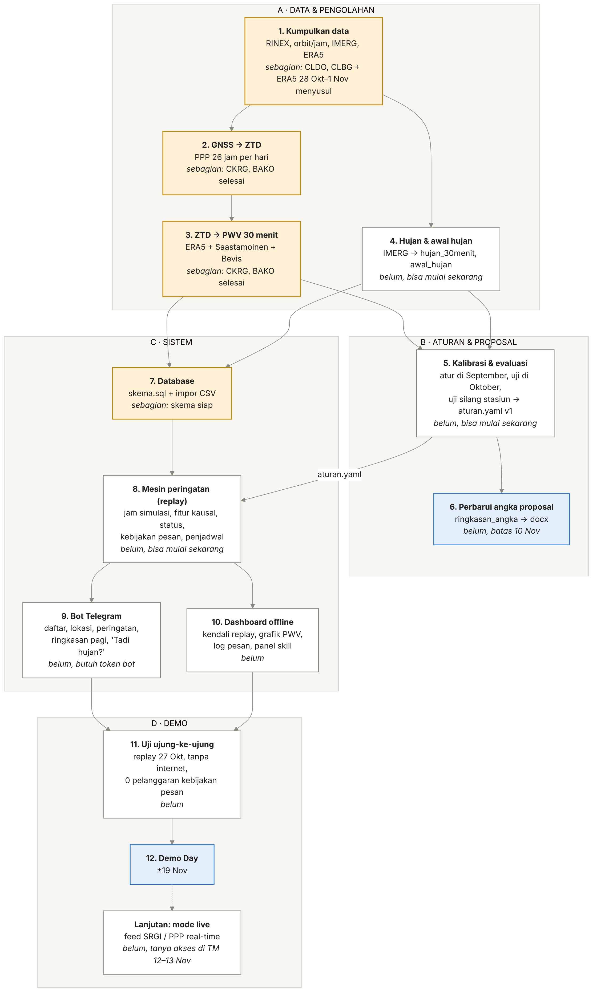
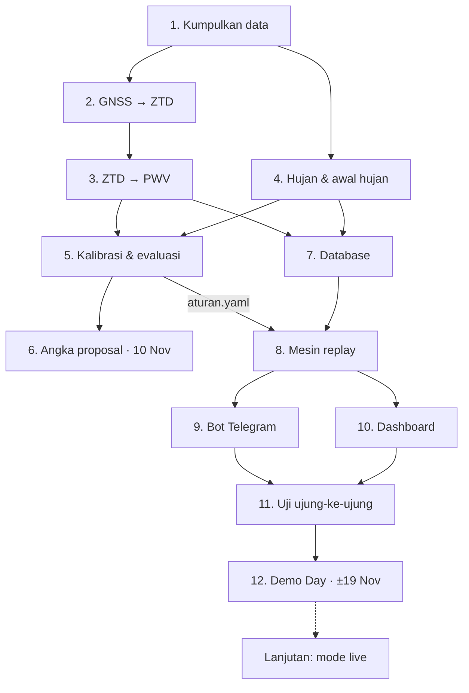

# Workflow AngkatDulu: dari data sampai Demo Day

Status per 9 Nov 2026. File ini diperbarui setiap ada tahap yang selesai.

Ada dua jalur yang bisa jalan **bersamaan**:

- **Jalur aturan** (tahap 4 → 5 → 6) menentukan ambang dan angka di proposal. Bagian ini yang butuh stasiun tambahan, karena CKRG sendiri hanya punya sedikit awal hujan. Sekarang sudah ada BAKO dan CLBG.
- **Jalur sistem** (tahap 7 → 8 → 9 → 10) membangun mesin, bot, dan dashboard. Bagian ini **tidak perlu menunggu** stasiun tambahan. Mesin membaca ambang dari `aturan.yaml`, jadi saat aturan v1 selesai cukup file itu yang diganti.

## Tahapan

| # | Tahap | Masukan | Keluaran | Dikerjakan | Status |
|---|---|---|---|---|---|
| 1 | Kumpulkan data | SRGI, CDDIS, Giovanni, Copernicus | RINEX, SP3/CLK, IMERG, ERA5 | Kamu | Selesai: 4 stasiun (CKRG, BAKO, CLBG, CJUR). ERA5 28–31 Okt belum bisa diunduh, celahnya diisi (galat ±0,3 mm) |
| 2 | GNSS → ZTD | RINEX, SP3/CLK, igs20.atx | `data/ztd/ztd_<st>.csv`, `qc_<st>.csv` | Claude | CKRG 50 hari, BAKO 47 hari, CLBG 56 hari, CJUR 62 hari |
| 3 | ZTD → PWV 30 menit | ZTD, ERA5 | `data/pwv/pwv_30menit_<st>.csv` | Claude | **Selesai** (9 Nov): 4 stasiun, ERA5 sampai 3 Nov, celah 28–31 Okt diisi |
| 4 | Hujan dan awal hujan | IMERG per stasiun | `hujan_30menit.csv`, `awal_hujan.csv` | Claude | Selesai, 4 stasiun: 66 awal hujan siang yang punya PWV (Sep 21, Okt 45) |
| 5 | Kalibrasi dan evaluasi | PWV, hujan, awal hujan | `aturan.yaml` v1, `ringkasan_angka.csv` | Claude | **Selesai** (9 Nov): `config/aturan.yaml` 1.1.0, PWV ≥ persentil 80. Uji silang: HSS 0,32, 16/66 awal hujan diperingatkan, 0,43 notifikasi/hari |
| 6 | Perbarui angka proposal | `ringkasan_angka.csv`, proposal v4 | proposal v5 (.docx) | Claude, kamu yang memeriksa | v7 siap (9 Nov, malam): review 12 + 6 poin (selang 95%, GPS vs GPS+GLONASS termasuk langit terhalang, "aman lagi" s.d. 15.00, hitungan notifikasi diperbaiki, sumber). Kamu: isi nama tim, kategori, CV, lalu ekspor PDF |
| 7 | Database | `skema.sql`, semua CSV | `angkatdulu.db` + `db/impor.py` | Claude | **Selesai** (5 Nov): 10.036 slot PWV, 11.816 slot hujan, 90 awal hujan, aturan aktif |
| 8 | Mesin peringatan (replay) | database, `aturan.yaml` | `mesin/`, `replay.py`, `tests/` | Claude | **Selesai** (5 Nov; diperbarui 9 Nov): 15 tes lulus, mesin = kalibrasi, 0 pelanggaran kebijakan pesan |
| 9 | Bot Telegram | mesin, token bot | `bot/`: daftar, kirim lokasi, peringatan, ringkasan pagi, "Tadi hujan?" | Claude, kamu menyiapkan token | **Selesai** (13 Nov): `demo_bot.py --replay`, diuji dengan Telegram tiruan dan di HP sungguhan |
| 10 | Dashboard offline | mesin, database | `dasbor/`: kendali replay, status 4 stasiun, grafik PWV + ambang + hujan, log pesan, rekam jejak | Claude | **Selesai** (13 Nov): dibuka otomatis oleh `demo_bot.py --replay`; 8 uji; panel live BAKO menunggu stream |
| 11 | Uji ujung-ke-ujung | semua di atas | replay 25 Okt jalan tanpa internet, 0 pelanggaran kebijakan pesan | Claude + kamu di laptop demo | Belum |
| 12 | Demo Day | | | Tim | ±19 Nov |
| – | Lanjutan: mode live | feed SRGI atau PPP real-time | `LiveSource` menggantikan `ReplaySource` | Setelah ada akses | Tanyakan di TM 12–13 Nov |

## Jadwal yang disarankan

| Tanggal | Jalur aturan | Jalur sistem |
|---|---|---|
| ~~Sel 3 – Kam 5 Nov~~ | ~~Aturan v1: PWV saja (sesuai proposal)~~ | ~~Tahap 7–8~~ selesai 5 Nov |
| Jum 6 Nov | | Mulai tahap 9 (bot), bila token sudah ada |
| ~~Sen 9 Nov~~ | ~~ERA5 1–3 Nov masuk: hitung ulang tahap 3 dan 5 (angka final)~~ selesai | |
| Sen 9 – Sel 10 Nov | Tahap 6: angka dan teks proposal diperbarui, kamu periksa | |
| **Sel 10 Nov** | **Kirim proposal** | |
| 10 – 13 Nov | | Tahap 9 (bot). TM 12–13 Nov: tanyakan akses data real-time SRGI |
| 14 – 16 Nov | | Tahap 10 (dashboard) |
| 17 – 18 Nov | | Tahap 11 di laptop demo, latihan alur cerita Bu Sri |
| **±19 Nov** | | **Demo Day** |

## Yang perlu kamu siapkan

- [x] **RINEX CLBG** 1 Sep–1 Nov. CLDO tidak dipakai (data SRGI berhenti 4 Sep).
- [x] RINEX **CJUR** DOY 244–306.
- [x] **IMERG CJUR** 1 Sep–1 Nov, kotak `107.1331,-6.8271,107.1431,-6.8171` → simpan di `ANGKATDULU`.
- [x] Orbit/jam yang belum lengkap (4 file; DOY 253 dan 255 di folder `products/2435`, DOY 257 dan 259 di folder `products/2436`): `COD0MGXFIN_20262530000_01D_30S_CLK.CLK.gz`, `COD0MGXFIN_20262550000_01D_30S_CLK.CLK.gz`, `COD0MGXFIN_20262570000_01D_05M_ORB.SP3.gz`, `COD0MGXFIN_20262590000_01D_30S_CLK.CLK.gz`. Menambah 4 hari September untuk CJUR dan 3 hari untuk CLBG.
- [x] ERA5 1–3 Nov.
- [ ] *(Opsional, setelah proposal)* ERA5 28–31 Okt kalau sudah bisa diunduh. Angka hampir tidak berubah, jadi tidak mendesak.
- [ ] Putuskan rekam jejak di pesan CKRG ("1 dari 26"): tampilkan apa adanya, gabungan 4 stasiun, atau sembunyikan.
- [ ] Siapkan HP dengan akun Telegram yang jadi "Bu Sri" saat demo.
- [ ] **Bot Telegram**: buat lewat @BotFather, lalu simpan tokennya di `config\.env` (contohnya di `config\env_contoh.txt`). Token jangan dikirim lewat chat.
- [ ] **Laptop demo**: pasang Python 3.11 atau lebih baru, lalu coba bagian "Menjalankan mesin di laptop" di README (4 perintah). Kabari kalau ada pesan error.
- [ ] Siapkan pertanyaan untuk TM soal akses ZWD/RINEX real-time SRGI.
- [ ] Hapus `download\_netrc.txt` kalau sudah tidak mengunduh dari CDDIS.

## Sumber diagram

