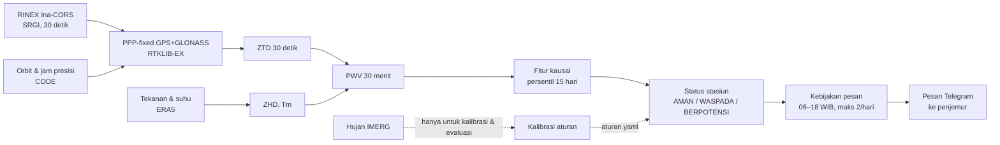

# AngkatDulu: indeks dokumentasi

Folder ini menyimpan semua dokumentasi AngkatDulu dalam file bernomor. Setiap file berdiri sendiri, jadi bisa dibaca sesuai kebutuhan. Status per **13 November 2026**.

## Gambaran singkat

AngkatDulu memakai stasiun GNSS Ina-CORS milik BIG sebagai sensor uap air. Sinyal satelit melambat saat melewati uap air di atmosfer; keterlambatan itu dihitung, diubah menjadi PWV (jumlah uap air di kolom udara di atas stasiun), lalu dipakai untuk memberi peringatan "berpotensi hujan" kepada petani dan pengolah hasil panen yang sedang menjemur. Persona demo: **Bu Sri**, petani gabah di Jayakerta, Karawang, dengan stasiun terdekat **CKRG**.



Dua jalur pemakaian:

- **Mode replay** (sudah jalan): data historis 1 Sep–1 Nov 2026 diputar ulang lewat mesin, seolah-olah real-time. Mesin tidak pernah melihat data masa depan.
- **Mode live** (sedang disiapkan): stream pengamatan + koreksi orbit/jam real-time → PPP real-time → PWV → mesin yang sama. Lihat [10_MODE_LIVE.md](10_MODE_LIVE.md).

## Daftar dokumen

| File | Isi | Kapan dibaca |
|---|---|---|
| [01_LATAR_BELAKANG.md](01_LATAR_BELAKANG.md) | Cerita Bu Sri, besar masalah, kenapa GNSS, sumber angka | menyusun pitch dan slide pembuka |
| [02_ISTILAH.md](02_ISTILAH.md) | Daftar istilah GNSS, cuaca, dan evaluasi | saat bertemu istilah asing |
| [03_DASAR_FISIKA.md](03_DASAR_FISIKA.md) | Rumus ZTD → ZHD/ZWD → PWV dan kepekaannya | menjawab pertanyaan teknis juri |
| [04_SUMBER_DATA_DAN_STASIUN.md](04_SUMBER_DATA_DAN_STASIUN.md) | Sumber data, latensi, metadata 4 stasiun | |
| [05_ALUR_PENGOLAHAN.md](05_ALUR_PENGOLAHAN.md) | Langkah RINEX → ZTD → PWV, hujan IMERG, kontrak data | menjalankan ulang pengolahan |
| [06_KALIBRASI_DAN_HASIL.md](06_KALIBRASI_DAN_HASIL.md) | Fitur, skema uji, hasil HSS, keterbatasan | slide hasil, sesi tanya jawab |
| [07_MESIN_PERINGATAN.md](07_MESIN_PERINGATAN.md) | Database, mesin, kebijakan pesan, replay, konfigurasi | membangun bot dan dashboard |
| [08_TECH_STACK.md](08_TECH_STACK.md) | Teknologi per lapisan dan alasannya | slide tech stack |
| [09_SISTEM_BOT_DASHBOARD.md](09_SISTEM_BOT_DASHBOARD.md) | Spesifikasi bot Telegram dan dashboard | tahap 9–10 |
| [10_MODE_LIVE.md](10_MODE_LIVE.md) | Stream real-time, akun IGS, BNC, status uji | menyiapkan demo live |
| [11_RENCANA_ML.md](11_RENCANA_ML.md) | Rencana model ML dan pengembangan lanjutan | slide masa depan, tanya jawab |
| [12_JUDGE_QA.md](12_JUDGE_QA.md) | Perkiraan pertanyaan juri dan jawabannya | latihan presentasi |
| [13_RENCANA_KERJA.md](13_RENCANA_KERJA.md) | To-do sampai Demo Day, tenggat, pembagian tugas | tiap hari |
| [14_PITCH_DAN_DEMO.md](14_PITCH_DAN_DEMO.md) | Naskah 5 menit, storyboard video 1 menit, kapan penilaian terjadi, checklist | menyusun PPT dan video |
| [15_OPERASIONAL.md](15_OPERASIONAL.md) | Kredensial, pemecahan masalah, daftar perintah | saat ada error |
| `PROSEDUR_ANGKATDULU.md` | Gabungan file 00–15 dalam satu file | untuk dibaca sekaligus atau dikirim |

`PROSEDUR_ANGKATDULU.md` dibuat ulang dari file bernomor. Kalau ada perubahan, ubah file bernomornya, lalu gabungkan lagi:

```bash
python -c "import glob;open('prosedur/PROSEDUR_ANGKATDULU.md','w',encoding='utf-8').write('\n\n'.join(open(f,encoding='utf-8').read() for f in sorted(glob.glob('prosedur/[0-9][0-9]_*.md'))))"
```

## Tenggat penting (Tech Meeting 12 Nov)

| Kapan | Apa |
|---|---|
| **Senin 16 Nov 2026, 23.59 WIB** | Kirim PPT/PDF + video 1 menit ke `kerjasama@big.go.id`, subjek "BIG Bhumireka 2026 – AngkatDulu" |
| **Kamis 19 Nov 2026, 08.00 WIB** | Demo Day di BIG Cibinong, Bogor. AngkatDulu tampil urutan 5 (sesi 10.00–10.30) |

## Struktur folder repo

```text
angkatdulu/
  prosedur/        dokumen ini
  pipeline/
    unduh/         unduh_cddis.py          unduh SP3/CLK CODE (di laptop)
    gnss/          siapkan_rinex.py        sisip FCN GLONASS ke RINEX 2.11
                   statis.sh               PPP-static satu hari (koordinat stasiun baru)
                   jalankan_ppp.py         PPP-fixed per hari, jendela 26 jam
                   ekstrak_ztd.py          .pos.stat → ztd_<st>.csv + qc_<st>.csv
                   konfig/                 konfigurasi rnx2rtkp per stasiun dan varian uji
    pwv/           pwv.py, grib1.py        ZTD + ERA5 → pwv_30menit_<st>.csv
                   grafik_pwv.py           grafik QC PWV + hujan
    hujan/         hujan.py                IMERG → hujan_30menit.csv + awal_hujan.csv
                   cek_kejadian.py         hitung awal hujan yang punya PWV
    evaluasi/      kalibrasi.py            pilih aturan → config/aturan.yaml
                   banding_gabungan.py     PWV vs pola harian/persistensi/gabungan
                   selang_hss.py           selang 95% HSS (bootstrap)
                   banding_gnss.py         GPS saja vs GPS+GLONASS (langit terhalang)
                   grafik_banding.py, grafik_replay.py
    v0_okt/        pipeline lama 18–28 Okt (arsip, hanya dibaca)
  data/            ztd/, pwv/, hujan/, evaluasi/ (hasil olahan)
  db/              skema.sql, impor.py → angkatdulu.db
  mesin/           mesin peringatan (fitur, aturan, kebijakan, template, sumber, jam)
  replay.py        putar ulang periode historis lewat mesin
  bot/             bot Telegram (klien Bot API, pendaftaran, "Tadi hujan?")
  dasbor/          dashboard lokal: server.py + index.html (tanpa internet)
  demo_bot.py      demo: replay + bot + dashboard
  tests/           32 uji otomatis
  config/          aturan.yaml, stasiun_live.yaml, env_contoh.txt
  docs/            gambar workflow, Gambar 3 proposal
```

Pembagian tempat kerja: PPP (berat, butuh `rnx2rtkp` dan produk orbit) dijalankan di workspace Claude (Linux). Mesin, replay, database, bot, dan dashboard dijalankan di laptop (Python 3.11+).
