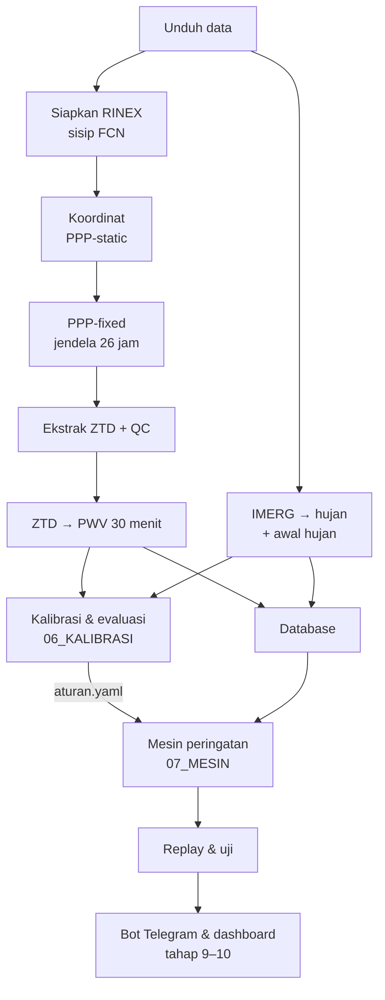

# Alur pengolahan data: RINEX sampai PWV dan hujan



## Unduh data

- **RINEX**: dari SRGI per stasiun per DOY (`<st><doy>0.26o` dan `.26n`). Disimpan per stasiun.
- **Orbit/jam**: `python pipeline/unduh/unduh_cddis.py --doy 244-306` (login Earthdata, mencari final MGEX → final CODE → rapid CODE). Hasil `.gz` dikirim ke workspace Claude.
- **ERA5**: unduh dari Copernicus CDS, variabel *surface pressure* dan *2m temperature*, per jam, kotak Jawa bagian barat, format GRIB. Boleh beberapa file (mis. per periode).
- **IMERG**: lewat Giovanni, *time series area-averaged*, IMERG Late 30 menit, kotak ±0,01° di sekitar tiap stasiun (contoh CJUR `107.1331,-6.8271,107.1431,-6.8171`), simpan CSV.

## Siapkan RINEX

`siapkan_rinex.py` menyisipkan baris `GLONASS SLOT / FRQ #` (FCN satelit R01–R24) ke header RINEX 2.11 → file `<st><doy>0_dengan_fcn.26o`. Tanpa ini RTKLIB tidak tahu frekuensi GLONASS karena file navigasi SRGI hanya berisi GPS.

## Koordinat stasiun (sekali per stasiun / per periode antena)

`statis.sh ST DOY KONFIG` menjalankan PPP-static per hari (konfig `sta_*.conf`). Koordinat tetap = median 7 hari, disimpan di `konfig/koordinat_<st>.txt` dan dimasukkan ke `ant1-pos1..3` di `fix_*.conf`.

- CJUR punya dua periode antena (lihat [04_SUMBER_DATA_DAN_STASIUN.md](04_SUMBER_DATA_DAN_STASIUN.md)), jadi ada `fix_cjur_a.conf` (DOY 244–266) dan `fix_cjur_b.conf` (DOY 267 ke atas).

## PPP-fixed per hari (`jalankan_ppp.py`)

```bash
python3 jalankan_ppp.py STASIUN DOY_AWAL DOY_AKHIR KONFIG
```

- **Jendela 26 jam**: data 22.00–24.00 UTC hari sebelumnya ditempelkan di depan hari D, diolah dengan SP3/CLK kedua hari, lalu hanya 00–24 UTC hari D yang disimpan. Masa konvergensi filter jatuh di hari sebelumnya, jadi tidak ada lubang pagi (07.00–08.00 WIB). Bila hari sebelumnya tidak ada, 1 jam pertama ditandai `KONVERGENSI`.
- Pengaturan utama `fix_*.conf` (RTKLIB-EX 2.5.1):

| Parameter | Nilai | Alasan |
|---|---|---|
| `pos1-posmode` | `ppp-fixed` | koordinat ditetapkan, fokus ke ZTD |
| `pos1-navsys` | `5` (GPS+GLONASS) | `1` = GPS saja untuk uji pembanding |
| `pos1-frequency` | `l1+l2` | kombinasi bebas ionosfer |
| `pos1-ionoopt` | `dual-freq` | |
| `pos1-tropopt` | `est-ztd` | ZTD ditaksir tiap epoch |
| `pos1-sateph` | `precise` | SP3 + CLK |
| `pos1-soltype` | `forward` | filter maju saja, kausal seperti real-time |
| `pos1-elmask` | `10` | `30` untuk simulasi langit terhalang (`*_g30`, `*_gr30`) |
| `pos1-tidecorr`, `posopt1–5` | `on` | pasang surut bumi, PCV satelit/receiver, dsb. |
| `pos2-armode` | `off` | ambiguitas float |
| `out-outstat` | `state` | `.pos.stat` berisi baris `$TROP` (ZTD) |

## Ekstrak ZTD dan QC (`ekstrak_ztd.py`)

```bash
python3 ekstrak_ztd.py STASIUN DOY_AWAL DOY_AKHIR
```

- `ztd_<st>.csv`: `waktu_utc, ztd_m, sigma_m, flag, produk` tiap 30 detik.
- `qc_<st>.csv`: satu baris per hari (status, jendela 26 jam, produk orbit, jumlah epoch, rata-rata satelit, σ ZTD, min/maks).
- Flag: `OK`, `KONVERGENSI`, `ORBIT_RAPID` (DOY 298–305 memakai produk rapid).

## ZTD → PWV 30 menit (`pwv.py`)

```bash
python3 pwv.py ERA5_a.grib [ERA5_b.grib ...] ztd_<st>.csv KODE
```

1. **Tinggi titik grid ERA5** ditaksir dari tekanan rata-ratanya terhadap baris laut (lintang −6,0) dengan rumus hipsometrik.
2. **Tiap jam**: tekanan grid diturunkan ke muka laut, diinterpolasi bilinear ke stasiun, lalu dinaikkan ke tinggi ortometrik stasiun. Suhu 2 m diperlakukan sama dengan laju penurunan 6,5 K/km.
3. **Celah ERA5** (28 Okt 10.00 – 31 Okt 23.00 UTC, 86 jam): diisi pola rata-rata per jam 14 hari sebelumnya ditambah anomali yang ditarik lurus dari 6 jam sebelum ke 6 jam sesudah celah, ditandai `METEO_ISI`. Uji 80 celah buatan: galat PWV rata-rata 0,26 mm.
4. ZHD, Tm, Π, PWV seperti di [03_DASAR_FISIKA.md](03_DASAR_FISIKA.md), lalu dirata-rata per slot 30 menit (`n_epoch` ≤ 60).
5. Keluaran `pwv_30menit_<st>.csv` (kolom di bagian Kontrak data, di bawah).

## Hujan IMERG (`hujan.py`)

```bash
python3 hujan.py CKRG=imerg_ckrg.csv BAKO=imerg_bako.csv ...
```

- `hujan_30menit.csv`: hujan mm/jam per slot per stasiun.
- `awal_hujan.csv`: awal hujan sesuai definisi di [02_ISTILAH.md](02_ISTILAH.md). Slot IMERG yang hilang dianggap tidak diketahui, bukan kering.
- `cek_kejadian.py` menghitung awal hujan siang (06–18 WIB) yang punya PWV cukup di 3 jam sebelumnya. Hasil: **66 awal hujan** (Sep 21, Okt 45).

## Kontrak data dan flag kualitas

**`data/pwv/pwv_30menit_<st>.csv`**

`waktu_utc, kode_stasiun, pwv_mm, sigma_pwv_mm, ztd_m, zhd_m, zwd_m, tekanan_hpa, suhu_k, tm_k, n_epoch, sumber_meteo, produk_orbit, flag_kualitas, run_id`

**`data/hujan/hujan_30menit.csv`**: `waktu_utc, kode_stasiun, hujan_mm_per_jam, sumber`

**`data/hujan/awal_hujan.csv`**: `kode_stasiun, waktu_utc, jam_wib, hujan_mm_per_jam, puncak_mm_per_jam, sumber, definisi`

**`data/ztd/ztd_<st>.csv`**: `waktu_utc, ztd_m, sigma_m, flag, produk`

| Flag | Arti | Dipakai mesin? |
|---|---|---|
| `OK` | normal | ya |
| `METEO_ISI` | tekanan/suhu dari pengisian celah ERA5 | ya |
| `ORBIT_RAPID` | orbit rapid, bukan final | ya |
| `KONVERGENSI` | 1 jam pertama tanpa jendela 26 jam | tidak |
| `CELAH` | data tidak cukup | tidak |

Konvensi waktu: semua disimpan **UTC** (ISO 8601, akhiran `Z`), ditampilkan **WIB = UTC + 7**.

---

Kembali ke [indeks](00_README.md).
