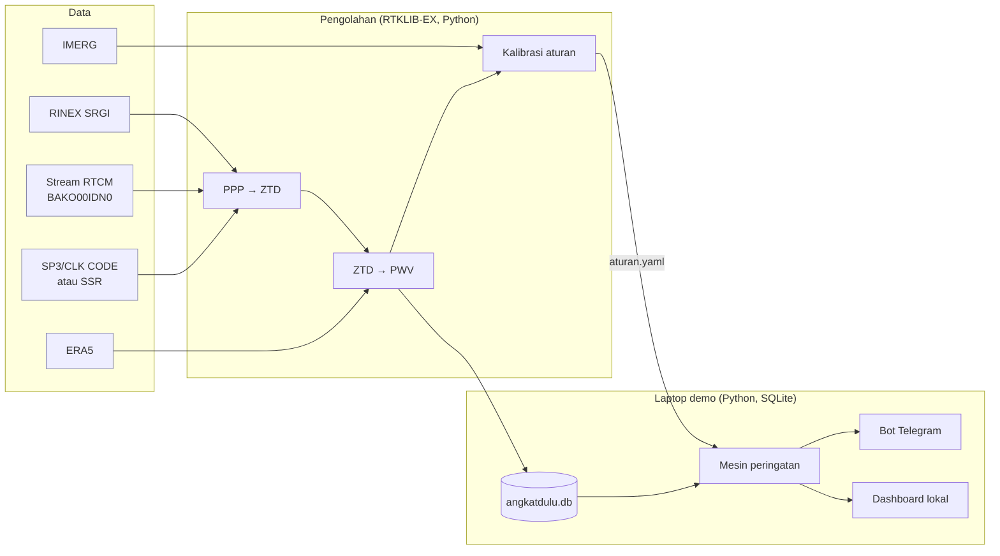

# Tech stack

Status: **berjalan** = sudah dipakai dan diuji; **rencana** = belum dibangun.

## Ringkasan per lapisan

| Lapisan | Teknologi | Status | Kenapa dipilih |
|---|---|---|---|
| Sumber pengamatan | Ina-CORS BIG: RINEX 2.11 dari SRGI (30 detik); stream RTCM 3 MSM7 `BAKO00IDN0` lewat IGS-IP | berjalan / uji | data nasional yang sudah ada, tanpa sensor baru |
| Orbit dan jam satelit | CODE MGEX final/rapid (SP3, CLK) dari NASA CDDIS; koreksi SSR `SSRA00CNE0` / `SSRA03IGS1` untuk live | berjalan / uji | gratis, multi-GNSS |
| Pengolahan GNSS | **RTKLIB-EX 2.5.1** (`rnx2rtkp` untuk olahan harian; `str2str` + `rtkrcv` untuk live), mode PPP-fixed GPS+GLONASS | berjalan / rencana | open-source, mendukung PPP, MSM7, dan SSR |
| Uji stream | **BNC 2.13.7** (BKG Ntrip Client) di Windows | uji | cara termudah memeriksa akun dan mountpoint NTRIP |
| Meteorologi | ERA5 (tekanan permukaan, suhu 2 m) GRIB1, dibaca `grib1.py` buatan sendiri | berjalan | tanpa pustaka berat (eccodes), jalan di Windows |
| Hujan (label) | GPM IMERG Late V07 30 menit lewat Giovanni | berjalan | satu-satunya data hujan 30 menit gratis untuk semua stasiun |
| Bahasa | **Python 3.11+**; bash untuk PPP batch | berjalan | satu bahasa untuk pipeline, mesin, bot |
| Pustaka Python | pandas ≥ 2.1, numpy, pyyaml, matplotlib, requests, pytest | berjalan | lihat `requirements.txt` |
| Penyimpanan | **SQLite** (15 tabel, 4 view) + CSV sesuai kontrak data | berjalan | satu file, tanpa server, cocok untuk laptop demo offline |
| Konfigurasi | YAML (`aturan.yaml`, `stasiun_live.yaml`), `.env` untuk rahasia | berjalan | aturan bisa diganti tanpa mengubah kode |
| Mesin peringatan | paket Python `mesin/` (fitur kausal, histeresis, kebijakan pesan, template) | berjalan | satu kode untuk kalibrasi, replay, dan live |
| Pengujian | pytest, 32 uji | berjalan | memastikan mesin = kalibrasi dan tidak melihat masa depan |
| Pesan ke pengguna | **Telegram Bot API** (HTTPS, *long polling* dengan `requests`) | berjalan | gratis, tanpa persetujuan bisnis, jalan dari laptop tanpa IP publik |
| Dashboard | halaman web lokal: `http.server` bawaan Python + satu `index.html` (CSS, JS, grafik SVG buatan sendiri, tanpa CDN) | berjalan | harus jalan tanpa internet saat demo |
| Diagram dan dokumen | Mermaid, Markdown, Word (proposal) | berjalan | |
| Lingkungan | workspace Linux (PPP, kalibrasi) + laptop Windows (mesin, replay, BNC, demo) | berjalan | PPP butuh `rnx2rtkp` dan produk orbit yang besar |

## Diagram arsitektur

## Alasan pilihan yang sering ditanya

- **Kenapa RTKLIB, bukan Bernese/GAMIT?** Gratis dan open-source, bisa real-time (`rtkrcv`), membaca MSM7 dan SSR. Bernese berbayar dan berorientasi olahan jaringan pascaproses.
- **Kenapa PPP satu stasiun, bukan jaringan?** Tiap stasiun berdiri sendiri, jadi stasiun yang mati tidak mengganggu yang lain, dan sistem mudah ditambah stasiun.
- **Kenapa Telegram, bukan WhatsApp?** Bot API Telegram gratis dan langsung bisa dipakai. WhatsApp Business API butuh verifikasi dan biaya per percakapan; masuk peta jalan tahun 4–6.
- **Kenapa SQLite?** Demo harus jalan tanpa internet dan tanpa server. Untuk skala nasional bisa pindah ke PostgreSQL tanpa mengubah skema besar-besaran.
- **Kenapa aturan, bukan langsung ML?** Data baru 2 bulan dan 66 awal hujan; aturan yang bisa dijelaskan lebih jujur dan mudah dikalibrasi. Rencana ML ada di [11_RENCANA_ML.md](11_RENCANA_ML.md).

---

Kembali ke [indeks](00_README.md).
