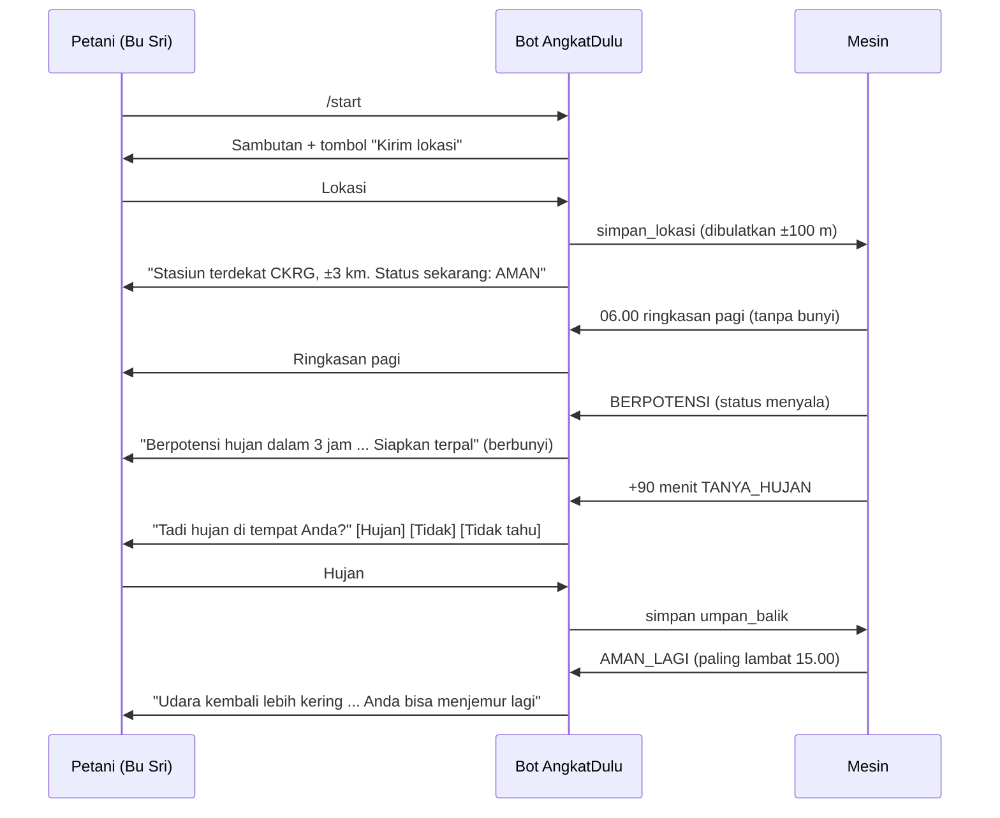
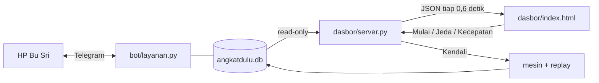

# Spesifikasi sistem: bot Telegram dan dashboard

Status: **bot sudah dibangun** (13 Nov, `bot/` + `demo_bot.py`, 6 uji dengan Telegram tiruan, diuji di HP sungguhan); **dashboard sudah dibangun** (13 Nov, `dasbor/`, 8 uji). Keduanya memakai mesin yang sudah ada (`mesin/`), tidak membuat logika peringatan baru. Bagian yang wajib ada untuk video demo ditandai **[video]**.

## Bot Telegram

### Alur pengguna

### Fitur

| Fitur | Keterangan | Prioritas |
|---|---|---|
| `/start` + kirim lokasi | pilih stasiun SEHAT terdekat (`pengguna.simpan_lokasi`), sebut jarak | wajib **[video]** |
| Pesan otomatis | RINGKASAN_PAGI, BERPOTENSI, AMAN_LAGI, TANYA_HUJAN dari tabel `pesan` yang jatuh tempo | wajib **[video]** |
| Tombol jawaban "Tadi hujan?" | *inline keyboard*, disimpan ke `umpan_balik` | wajib **[video]** |
| `/status` | status stasiun, PWV terakhir, waktu data terakhir | wajib |
| `/berhenti` | nonaktifkan langganan | wajib |
| Label replay | pesan mode replay diawali `[REPLAY · tanggal jam WIB]` supaya jujur | wajib |
| `/bantuan` | penjelasan singkat dan arti status | opsional |

### Cara kerja teknis

- Bot memakai Telegram Bot API dengan *long polling* (`getUpdates`), jadi laptop tidak butuh IP publik.
- `PengirimLog` di mesin diganti `PengirimTelegram` yang memanggil `sendMessage`; notifikasi berbunyi, sisanya `disable_notification=true`.
- Token dibaca dari `config\.env` (`TELEGRAM_BOT_TOKEN`), tidak pernah ditulis di kode.
- Mode demo: jam replay (`JamReplay`) dipercepat, pesan dikirim ke chat HP "Bu Sri" yang sungguhan.
- Kebijakan pesan tetap dari `mesin/kebijakan.py`; target 0 pelanggaran (`periksa.py`).

## Dashboard lokal

Satu halaman web di laptop, jalan tanpa internet.

| Panel | Isi | Prioritas |
|---|---|---|
| Stasiun | 4 stasiun dengan warna status (AMAN, WASPADA, BERPOTENSI, TANPA_DATA), jarak ke titik Bu Sri | wajib **[video]** |
| Grafik PWV | PWV 48 jam terakhir, garis persentil 80 dan 65, arsiran BERPOTENSI, batang hujan IMERG, tanda notifikasi (seperti Gambar 3 proposal) | wajib **[video]** |
| Log pesan | waktu, jenis, TERKIRIM/DITAHAN + alasan (`DI_LUAR_JAM`, `LEWAT_JAM_JEMUR`, `KUOTA_HARIAN`) | wajib **[video]** |
| Kendali replay | mulai, jeda/lanjutkan, kecepatan, putar ulang (tanggal lain lewat `--mulai`/`--selesai`) | wajib |
| Rekam jejak | "x dari n peringatan siang serupa diikuti hujan", sama dengan kalimat di pesan | wajib |
| Panel live BAKO | jumlah satelit per sistem (G/R/E/C), umur data, ZTD/PWV terakhir | bila stream jalan |
| Panel PWV BIG | PWV kiriman BIG dibanding PWV kita | bila data datang |

Teknis: `dasbor/server.py` (server `http.server` bawaan Python, hanya 127.0.0.1) membaca `angkatdulu.db` lewat koneksi read-only; mesin dan bot tetap satu-satunya penulis. Halaman `dasbor/index.html` menanyakan `/api/keadaan` tiap 0,6 detik dan mengirim tombol ke `/api/kendali`. Grafik digambar sendiri dengan SVG, tanpa pustaka dan tanpa CDN.

Garis batas di grafik dihitung dengan cara yang sama dengan mesin (15 hari sampai 12 jam sebelum waktu keputusan), dan diuji: PWV di atas garis berpotensi tepat sama dengan persentil ≥ 80 di tabel `status_stasiun`. Hujan IMERG hanya ditampilkan untuk slot yang sudah lewat, supaya layar tidak "melihat masa depan".

## Kriteria selesai

- [x] Replay 25 Okt 2026 (CKRG) jalan dari awal sampai akhir **tanpa internet** untuk dashboard (`--tanpa-bot`).
- [x] Pesan BERPOTENSI 06.30 muncul di HP "Bu Sri" sesuai log mesin.
- [x] Tombol "Tadi hujan?" tersimpan di `umpan_balik` dan tampil di dashboard.
- [x] 0 pelanggaran kebijakan pesan.
- [x] Semua uji lama tetap lulus, ditambah uji untuk bot dan dashboard (32 uji).
- [ ] Uji ujung-ke-ujung di laptop demo (bot + dashboard + HP), lalu rekam video.

---

Kembali ke [indeks](00_README.md).
