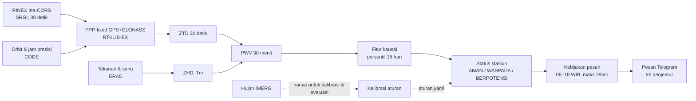
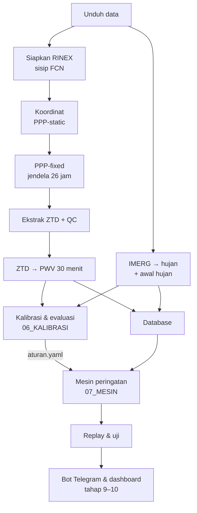
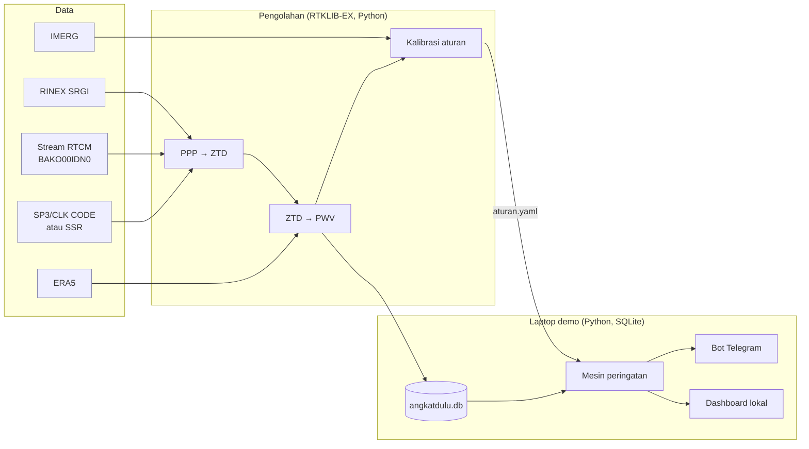
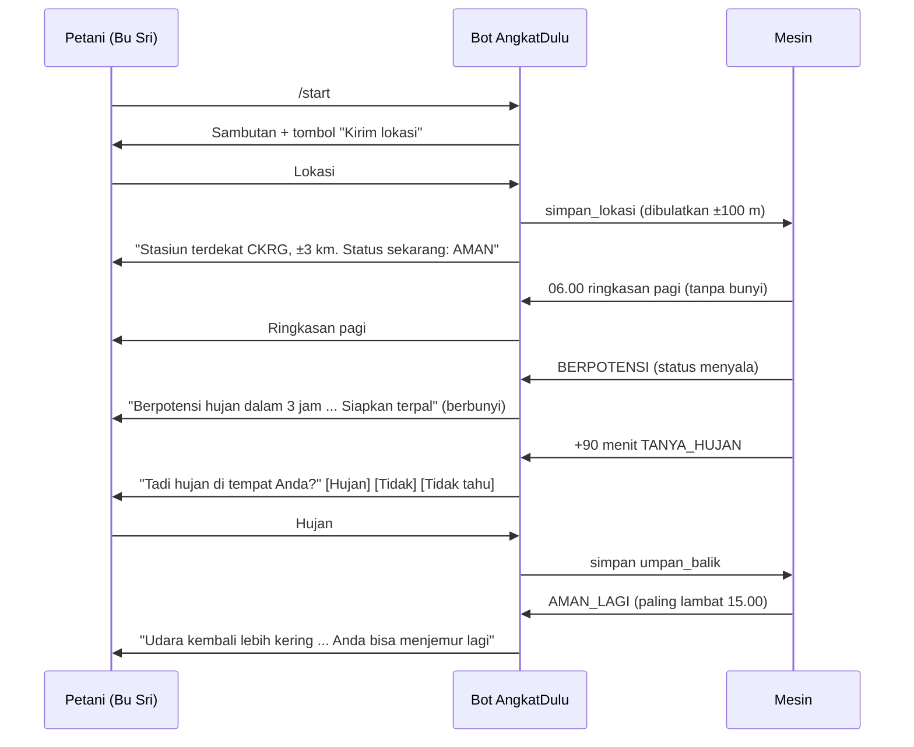
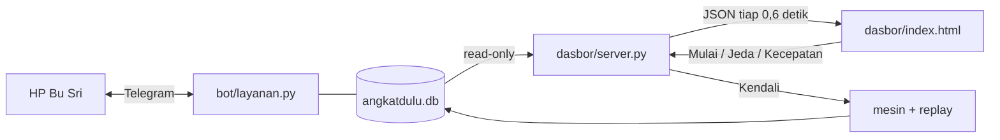

# AngkatDulu: indeks dokumentasi

Folder ini menyimpan semua dokumentasi AngkatDulu dalam file bernomor. Setiap file berdiri sendiri, jadi bisa dibaca sesuai kebutuhan. Status per **13 November 2026**.

## Gambaran singkat

AngkatDulu memakai stasiun GNSS Ina-CORS milik BIG sebagai sensor uap air. Sinyal satelit melambat saat melewati uap air di atmosfer; keterlambatan itu dihitung, diubah menjadi PWV (jumlah uap air di kolom udara di atas stasiun), lalu dipakai untuk memberi peringatan "berpotensi hujan" kepada petani dan pengolah hasil panen yang sedang menjemur. Persona demo: **Bu Sri**, petani gabah di Jayakerta, Karawang, dengan stasiun terdekat **CKRG**.



Dua jalur pemakaian:

- **Mode replay** (sudah jalan): data historis 1 Sep–1 Nov 2026 diputar ulang lewat mesin, seolah-olah real-time. Mesin tidak pernah melihat data masa depan.
- **Mode live** (sedang disiapkan): stream pengamatan + koreksi orbit/jam real-time → PPP real-time → PWV → mesin yang sama. Lihat [10_MODE_LIVE.md](10_MODE_LIVE.md).

## Daftar dokumen

| File | Isi | Kapan dibaca |
|---|---|---|
| [01_LATAR_BELAKANG.md](01_LATAR_BELAKANG.md) | Cerita Bu Sri, besar masalah, kenapa GNSS, sumber angka | menyusun pitch dan slide pembuka |
| [02_ISTILAH.md](02_ISTILAH.md) | Daftar istilah GNSS, cuaca, dan evaluasi | saat bertemu istilah asing |
| [03_DASAR_FISIKA.md](03_DASAR_FISIKA.md) | Rumus ZTD → ZHD/ZWD → PWV dan kepekaannya | menjawab pertanyaan teknis juri |
| [04_SUMBER_DATA_DAN_STASIUN.md](04_SUMBER_DATA_DAN_STASIUN.md) | Sumber data, latensi, metadata 4 stasiun | |
| [05_ALUR_PENGOLAHAN.md](05_ALUR_PENGOLAHAN.md) | Langkah RINEX → ZTD → PWV, hujan IMERG, kontrak data | menjalankan ulang pengolahan |
| [06_KALIBRASI_DAN_HASIL.md](06_KALIBRASI_DAN_HASIL.md) | Fitur, skema uji, hasil HSS, keterbatasan | slide hasil, sesi tanya jawab |
| [07_MESIN_PERINGATAN.md](07_MESIN_PERINGATAN.md) | Database, mesin, kebijakan pesan, replay, konfigurasi | membangun bot dan dashboard |
| [08_TECH_STACK.md](08_TECH_STACK.md) | Teknologi per lapisan dan alasannya | slide tech stack |
| [09_SISTEM_BOT_DASHBOARD.md](09_SISTEM_BOT_DASHBOARD.md) | Spesifikasi bot Telegram dan dashboard | tahap 9–10 |
| [10_MODE_LIVE.md](10_MODE_LIVE.md) | Stream real-time, akun IGS, BNC, status uji | menyiapkan demo live |
| [11_RENCANA_ML.md](11_RENCANA_ML.md) | Rencana model ML dan pengembangan lanjutan | slide masa depan, tanya jawab |
| [12_JUDGE_QA.md](12_JUDGE_QA.md) | Perkiraan pertanyaan juri dan jawabannya | latihan presentasi |
| [13_RENCANA_KERJA.md](13_RENCANA_KERJA.md) | To-do sampai Demo Day, tenggat, pembagian tugas | tiap hari |
| [14_PITCH_DAN_DEMO.md](14_PITCH_DAN_DEMO.md) | Naskah 5 menit, storyboard video 1 menit, kapan penilaian terjadi, checklist | menyusun PPT dan video |
| [15_OPERASIONAL.md](15_OPERASIONAL.md) | Kredensial, pemecahan masalah, daftar perintah | saat ada error |
| `PROSEDUR_ANGKATDULU.md` | Gabungan file 00–15 dalam satu file | untuk dibaca sekaligus atau dikirim |

`PROSEDUR_ANGKATDULU.md` dibuat ulang dari file bernomor. Kalau ada perubahan, ubah file bernomornya, lalu gabungkan lagi:

```bash
python -c "import glob;open('prosedur/PROSEDUR_ANGKATDULU.md','w',encoding='utf-8').write('\n\n'.join(open(f,encoding='utf-8').read() for f in sorted(glob.glob('prosedur/[0-9][0-9]_*.md'))))"
```

## Tenggat penting (Tech Meeting 12 Nov)

| Kapan | Apa |
|---|---|
| **Senin 16 Nov 2026, 23.59 WIB** | Kirim PPT/PDF + video 1 menit ke `kerjasama@big.go.id`, subjek "BIG Bhumireka 2026 – AngkatDulu" |
| **Kamis 19 Nov 2026, 08.00 WIB** | Demo Day di BIG Cibinong, Bogor. AngkatDulu tampil urutan 5 (sesi 10.00–10.30) |

## Struktur folder repo

```text
angkatdulu/
  prosedur/        dokumen ini
  pipeline/
    unduh/         unduh_cddis.py          unduh SP3/CLK CODE (di laptop)
    gnss/          siapkan_rinex.py        sisip FCN GLONASS ke RINEX 2.11
                   statis.sh               PPP-static satu hari (koordinat stasiun baru)
                   jalankan_ppp.py         PPP-fixed per hari, jendela 26 jam
                   ekstrak_ztd.py          .pos.stat → ztd_<st>.csv + qc_<st>.csv
                   konfig/                 konfigurasi rnx2rtkp per stasiun dan varian uji
    pwv/           pwv.py, grib1.py        ZTD + ERA5 → pwv_30menit_<st>.csv
                   grafik_pwv.py           grafik QC PWV + hujan
    hujan/         hujan.py                IMERG → hujan_30menit.csv + awal_hujan.csv
                   cek_kejadian.py         hitung awal hujan yang punya PWV
    evaluasi/      kalibrasi.py            pilih aturan → config/aturan.yaml
                   banding_gabungan.py     PWV vs pola harian/persistensi/gabungan
                   selang_hss.py           selang 95% HSS (bootstrap)
                   banding_gnss.py         GPS saja vs GPS+GLONASS (langit terhalang)
                   grafik_banding.py, grafik_replay.py
    v0_okt/        pipeline lama 18–28 Okt (arsip, hanya dibaca)
  data/            ztd/, pwv/, hujan/, evaluasi/ (hasil olahan)
  db/              skema.sql, impor.py → angkatdulu.db
  mesin/           mesin peringatan (fitur, aturan, kebijakan, template, sumber, jam)
  replay.py        putar ulang periode historis lewat mesin
  bot/             bot Telegram (klien Bot API, pendaftaran, "Tadi hujan?")
  dasbor/          dashboard lokal: server.py + index.html (tanpa internet)
  demo_bot.py      demo: replay + bot + dashboard
  tests/           32 uji otomatis
  config/          aturan.yaml, stasiun_live.yaml, env_contoh.txt
  docs/            gambar workflow, Gambar 3 proposal
```

Pembagian tempat kerja: PPP (berat, butuh `rnx2rtkp` dan produk orbit) dijalankan di workspace Claude (Linux). Mesin, replay, database, bot, dan dashboard dijalankan di laptop (Python 3.11+).


# Latar belakang: kenapa AngkatDulu ada

## Cerita Bu Sri

Bagi kebanyakan orang, jemuran kehujanan berarti baju dicuci ulang. Lain ceritanya dengan **Bu Sri** (persona ilustratif), petani gabah di Jayakerta, Karawang, yang menghamparkan gabah hasil kerja empat bulan di lantai jemur depan rumah. Begitu langit tiba-tiba gelap, ia hanya punya beberapa menit untuk menyapu gabah dan menutupnya dengan terpal, sering kali sendirian.

Yang dibutuhkan Bu Sri adalah satu keputusan sederhana: **angkat sekarang atau tunggu**. Bukan peta cuaca, bukan istilah meteorologi.

## Besar masalahnya

| Fakta | Angka | Sumber |
|---|---|---|
| Susut padi saat penjemuran | 3,59% | Ditjen PPHP, Kementerian Pertanian (2008) |
| Produksi padi 2025 | 71,95 juta ton GKP | BPS (2026) |
| Harga Pembelian Pemerintah gabah | Rp6.500/kg | Bapanas (2025) |
| Nilai susut penjemuran (batas atas) | ±Rp16,8 triliun per tahun | hitungan dari tiga baris di atas |
| Per petani berlahan 0,5 ha | ±Rp742 ribu per panen | hitungan yang sama |
| Awal musim hujan 2026/2027 mundur | 61,08% daratan Indonesia | BMKG (2026) |
| Rumah tangga usaha pertanian | 28,4 juta (16,89 juta petani gurem) | Sensus Pertanian 2023, BPS |
| Rumah tangga tanaman pangan / perkebunan | 15,55 juta / 10,88 juta | BPS (2023) |
| Penetrasi internet perdesaan | 76,96% | APJII (2025) |

Catatan kejujuran: tidak semua susut disebabkan hujan, dan sebagian petani menjual gabah basah ke penebas. Angka Rp16,8 triliun hanya menunjukkan **skala masalah**, belum manfaat AngkatDulu. Sasaran kami adalah rumah tangga yang masih menjemur sendiri, termasuk pengolah ikan asin di Roban Timur, Batang, yang bisa merugi jutaan rupiah saat hujan atau mendung (Mongabay, 2025).

Musim peralihan yang panjang membuat masalah ini makin terasa: hujan bisa turun di sela hari-hari cerah, justru saat petani paling berani menjemur.

## Celah yang diisi

- **Peringatan BMKG** (*nowcasting* 0–6 jam) menggambarkan cuaca per wilayah dan tidak dirancang sebagai saran tindakan bagi penjemur.
- **Radar cuaca BMKG** baru 44 unit per Maret 2026 (InfoPublik, 2026), sementara banyak sentra pertanian di luar jangkauannya.
- **474 stasiun Ina-CORS milik BIG** sudah merekam sinyal satelit setiap detik, dan sinyal itu melambat sebanding dengan uap air yang dilewatinya. Datanya belum diolah menjadi pesan untuk orang yang sedang menjemur.

## Kenapa GNSS

- **Sudah ada**: tidak perlu sensor baru, biaya komponen prototipe Rp0.
- **Mengukur uap air sebelum awan hujan terbentuk**: PWV naik sebelum hujan konvektif, sedangkan radar baru melihat butir hujan.
- **Tersedia di wilayah tanpa radar**, terus-menerus, siang dan malam, dalam segala cuaca.
- **Dasar ilmiahnya mapan** sejak Bevis dkk. (1992); di Indonesia, PWV Ina-CORS berbeda 2,59 mm (RMSD) dari ERA5 (Wijaya dkk., 2024).
- **Sesuai tema multi-GNSS**: GPS + GLONASS membuat ZTD tetap tersedia saat sebagian langit terhalang (lihat [06_KALIBRASI_DAN_HASIL.md](06_KALIBRASI_DAN_HASIL.md)).

## Posisi terhadap layanan yang sudah ada

- **Modul ZWD real-time SRGI** sudah menghitung ZWD tiap stasiun. AngkatDulu bekerja di hilirnya: ZWD → PWV → keputusan di HP petani.
- **BMKG**: AngkatDulu melengkapi, bukan menggantikan. Pesannya selalu menyebut stasiun dan jarak, dan rekam jejaknya terbuka.

## Kebaruan

Kontribusi kami ada pada rantai yang utuh dari ZWD sampai keputusan di lantai jemur:

1. Ambang per stasiun (persentil 15 hari terakhir), karena ambang mutlak gagal di dataran tinggi.
2. Kebijakan pesan yang menghormati penerima: hanya 06.00–18.00, maksimal 2 notifikasi per hari, "aman lagi" hanya sampai 15.00.
3. Rekam jejak terbuka di setiap pesan, dan jawaban "Tadi hujan?" untuk mengalibrasi ulang ambang.

## Daftar pustaka

- APJII. (2025). *Survei Penetrasi Internet Indonesia 2025*.
- Badan Informasi Geospasial. (2025). *Rencana Strategis BIG 2025–2029*. Data RINEX Ina-CORS: srgi.big.go.id.
- Badan Pangan Nasional. (2025). Keputusan Kepala Badan Pangan Nasional Nomor 14 Tahun 2025 (HPP dan rafaksi harga gabah dan beras).
- BPS. (2023). *Hasil Pencacahan Lengkap Sensus Pertanian 2023*.
- BPS. (2026). Luas panen dan produksi padi di Indonesia 2025 (angka tetap). Berita Resmi Statistik, 2 Februari 2026.
- Benevides, P., Catalão, J., & Miranda, P. M. A. (2015). On the inclusion of GPS precipitable water vapour in the nowcasting of rainfall. *NHESS*, 15, 2605–2616.
- Bevis, M., dkk. (1992). GPS meteorology: Remote sensing of atmospheric water vapor using the Global Positioning System. *JGR*, 97(D14), 15787–15801.
- Bevis, M., dkk. (1994). GPS meteorology: Mapping zenith wet delays onto precipitable water. *J. Appl. Meteorol.*, 33(3), 379–386.
- BMKG. (2026). *Prakiraan Musim Hujan 2026/2027 di Indonesia*.
- CODE. (2026). Produk orbit dan jam presisi MGEX dan rapid, melalui NASA CDDIS.
- Ditjen PPHP, Departemen Pertanian. (2008). Data susut panen dan pascapanen padi.
- Hersbach, H., dkk. (2020). The ERA5 global reanalysis. *QJRMS*, 146(730), 1999–2049.
- Huffman, G. J., dkk. (2023). GPM IMERG Late Precipitation L3 Half Hourly V07. NASA GES DISC.
- InfoPublik. (2026, 18 Maret). HMD 2026, BMKG perkuat sistem observasi untuk lindungi masa depan.
- Landskron, D., & Böhm, J. (2018). VMF3/GPT3: Refined discrete and empirical troposphere mapping functions. *J. Geod.*, 92(4), 349–360.
- Mongabay. (2025, 13 Juli). Cerita perempuan nelayan terdampak PLTU Batang.
- Richardson, D. S. (2000). Skill and relative economic value of the ECMWF ensemble prediction system. *QJRMS*, 126(563), 649–667.
- rtklibexplorer. (2025). RTKLIB-EX 2.5.1. github.com/rtklibexplorer/RTKLIB.
- Saastamoinen, J. (1972). Atmospheric correction for the troposphere and stratosphere in radio ranging of satellites. *Geophysical Monograph 15*, 247–251.
- Weber, G., Dettmering, D., & Gebhard, H. (2005). Networked Transport of RTCM via Internet Protocol (NTRIP). *IAG Symposia*, 128, 60–64. (wajib dikutip bila memakai data IGS-IP dalam publikasi)
- Wijaya, D. D., dkk. (2024). Determination and assessment of GNSS-derived precipitable water vapor in Indonesia using Ina-CORS. *Adv. Space Res.*, 73(1), 386–403.

---

Kembali ke [indeks](00_README.md).


# Istilah dan pengertian

| Istilah | Arti |
|---|---|
| **GNSS** | Sistem satelit navigasi global: GPS (AS), GLONASS (Rusia), Galileo (Eropa), BeiDou (Tiongkok), QZSS (Jepang). |
| **Multi-GNSS** | Memakai lebih dari satu sistem sekaligus. Lebih banyak satelit → solusi lebih stabil, terutama saat sebagian langit terhalang. |
| **Ina-CORS** | Jaringan stasiun GNSS permanen milik BIG (±474 stasiun). Kita memakai CKRG, BAKO, CLBG, CJUR. |
| **SRGI** | Portal BIG (`srgi.big.go.id`) tempat mengunduh RINEX harian Ina-CORS. |
| **RINEX** | Format teks standar data pengamatan GNSS. SRGI menyediakan RINEX 2.11, interval 30 detik, tersedia H+1 sekitar 02.00 UTC (09.00 WIB). |
| **RTCM 3 / MSM** | Format biner untuk stream real-time. MSM5/MSM7 memuat pengamatan multi-GNSS lengkap. |
| **NTRIP, caster, mountpoint** | Protokol untuk mengalirkan RTCM lewat internet. *Caster* adalah servernya, *mountpoint* adalah nama satu stream (mis. `BAKO00IDN0`). |
| **Source table** | Daftar mountpoint di sebuah caster, termasuk format, sistem satelit, dan lokasi. |
| **PPP** | *Precise Point Positioning*: mengolah satu stasiun saja dengan orbit dan jam satelit presisi. Menghasilkan posisi dan keterlambatan troposfer. |
| **PPP-static** | PPP yang menaksir koordinat stasiun (dipakai sekali untuk mendapat koordinat tetap). |
| **PPP-fixed** | Istilah RTKLIB untuk PPP dengan **koordinat stasiun ditetapkan** (bukan "ambiguitas di-fix"). Karena posisi tidak ikut ditaksir, ZTD lebih stabil. |
| **SP3 / CLK** | File orbit (SP3, per 5 menit) dan jam satelit (CLK, per 30 detik) dari pusat analisis, di sini CODE. |
| **Final / rapid** | Produk final paling teliti tapi terbit ±2 minggu; rapid terbit H+1 dan sedikit kurang teliti. |
| **SSR** | *State Space Representation*: koreksi orbit, jam, dan bias satelit yang dialirkan real-time (mis. `SSRA00CNE0`). Pengganti SP3/CLK untuk mode live. |
| **ANTEX (`igs20.atx`)** | Kalibrasi pusat fase antena satelit dan receiver. |
| **Radome** | Kubah pelindung antena (mis. SCIS, LEIM, LEIS). Memengaruhi kalibrasi antena. |
| **FCN GLONASS** | Nomor kanal frekuensi tiap satelit GLONASS. Header RINEX 2.11 SRGI tidak memuatnya, jadi disisipkan oleh `siapkan_rinex.py`. |
| **ZTD** | *Zenith Total Delay*: keterlambatan total sinyal di arah zenit akibat troposfer (±2,5 m). |
| **ZHD** | *Zenith Hydrostatic Delay*: bagian ZTD akibat udara kering, dihitung dari tekanan (±2,3 m). |
| **ZWD** | *Zenith Wet Delay* = ZTD − ZHD: bagian akibat uap air (±0,2–0,3 m). |
| **PWV** | *Precipitable Water Vapor*: tebal air (mm) jika semua uap air di kolom udara diembunkan. Di Jawa barat umumnya 25–60 mm. |
| **Tm** | Suhu rata-rata berbobot atmosfer basah (K), dipakai untuk konversi ZWD → PWV. |
| **Π (Pi)** | Faktor konversi ZWD → PWV, ±0,16. |
| **ERA5** | Reanalisis cuaca ECMWF per jam, grid 0,25°. Dipakai untuk tekanan permukaan dan suhu 2 m. Terbit ±5 hari kemudian. |
| **IMERG** | Estimasi hujan satelit NASA GPM per 30 menit. Diunduh lewat Giovanni (IMERG Late V07). Dipakai hanya untuk kalibrasi dan evaluasi. |
| **Slot** | Satu blok waktu 30 menit. Slot *t* adalah [t, t+30 menit). |
| **Tick / τ (tau)** | Saat mesin mengambil keputusan, di akhir slot (t + 30 menit). |
| **Kausal** | Keputusan di τ hanya memakai data yang sudah tersedia sebelum τ. |
| **Persentil** | Peringkat PWV 1 jam terakhir terhadap PWV 15 hari terakhir di stasiun yang sama (0–100). |
| **Histeresis** | Status tidak langsung padam saat syarat hilang, menunggu 60 menit, supaya tidak berkedip. |
| **Level** | AMAN, WASPADA (Level 1, persentil ≥ 65), BERPOTENSI (Level 2, persentil ≥ 80), TANPA_DATA. |
| **Awal hujan** | Slot pertama ≥ 0,2 mm/jam setelah ≥ 3 jam kering, dan kejadiannya mencapai puncak ≥ 1 mm/jam. |
| **P-3J** | Kebenaran per slot: ada hujan ≥ 1 mm/jam dalam 3 jam setelah τ. |
| **E-3J** | Awal hujan siang "tertangkap" bila ada notifikasi BERPOTENSI 0–3 jam sebelumnya. |
| **HSS** | *Heidke Skill Score*: 0 = setara tebakan acak, 1 = sempurna. Skor utama kita. |
| **POD / FAR** | *Probability of Detection* (hujan yang tertangkap) / *False Alarm Ratio* (peringatan yang meleset). |
| **LOSO** | *Leave-one-station-out*: ambang dipilih di 3 stasiun, diuji di stasiun ke-4, bergiliran. |
| **Bootstrap** | Pengambilan ulang hari-stasiun secara acak (2.000 kali) untuk menghitung selang kepercayaan 95%. |
| **Persistensi** | Pembanding "kemarin hujan di jam yang sama, hari ini hujan lagi". |
| **Pola harian** | Pembanding "waspada tiap 13.00–17.00 WIB". |
| **Rekam jejak** | Kalimat di pesan: "Bulan lalu di 4 stasiun, x dari n peringatan siang serupa diikuti hujan." |

---

Kembali ke [indeks](00_README.md).


# Dasar fisika: dari sinyal satelit ke PWV

1. **ZTD dari PPP.** RTKLIB menaksir ZTD bersama jam receiver dan ambiguitas fase, tiap 30 detik, dengan koordinat stasiun ditetapkan.
2. **ZHD dari tekanan** (Saastamoinen):

   ```
   ZHD [m] = 0,0022768 · P [hPa] / (1 − 0,00266 · cos 2φ − 0,00028 · h_elipsoid [km])
   ```

3. **ZWD** = ZTD − ZHD.
4. **Tm dari suhu permukaan** (Bevis): `Tm = 70,2 + 0,72 · Ts` (K).
5. **Faktor konversi**:

   ```
   Π = 10⁶ / (ρw · Rv · (k3 / Tm + k2′))
   ρw = 1000 kg/m³, Rv = 461,5 J/(kg·K), k2′ = 22,1 K/hPa, k3 = 3,739·10⁵ K²/hPa
   ```

6. **PWV** = Π · ZWD (dalam mm). Rata-rata Π di data kita 0,164.

Kepekaan penting:

- 1 mm ZTD ≈ 0,16 mm PWV.
- 1 hPa galat tekanan ≈ 2,3 mm ZHD ≈ 0,37 mm PWV. Karena itu tekanan stasiun dihitung hati-hati (langkah ZTD → PWV di [05_ALUR_PENGOLAHAN.md](05_ALUR_PENGOLAHAN.md)).
- Uji dengan tekanan dan suhu konstan hanya menggeser PWV 0,64 mm (RMS), jadi untuk mode live model empiris (GPT3 atau rata-rata ERA5 per stasiun) cukup.

---

Kembali ke [indeks](00_README.md).


# Sumber data dan metadata stasiun

## Sumber data

| Data | Sumber | Format, resolusi | Latensi | Dipakai untuk |
|---|---|---|---|---|
| Pengamatan GNSS | SRGI (`srgi.big.go.id`), akun peserta | RINEX 2.11 (`.26o` + navigasi `.26n`), 30 detik | H+1, ±09.00 WIB | PPP → ZTD |
| Orbit & jam | CODE lewat CDDIS (`unduh_cddis.py`), akun Earthdata | SP3 5 menit, CLK 30 detik (`COD0MGXFIN`, cadangan `COD0OPSFIN`/`COD0OPSRAP`) | final ±2 minggu, rapid H+1 | PPP |
| Kalibrasi antena | IGS | `igs20.atx` | tetap | PPP |
| Tekanan & suhu | Copernicus CDS, ERA5 single levels | GRIB1, per jam, grid 0,25° (surface pressure, 2 m temperature) | ±5 hari | ZHD, Tm |
| Hujan | NASA GES DISC lewat Giovanni | CSV rata-rata area kotak kecil per stasiun, IMERG Late V07, 30 menit | ±14 jam (Late) | label kalibrasi & evaluasi, bukan input keputusan |
| Kesehatan & hardware stasiun | `nrtk.big.go.id` (akun peserta) | halaman web | live | metadata antena, status online |
| Stream real-time (rencana) | IGS-IP (`igs-ip.net`, `products.igs-ip.net`), akun BKG | RTCM 3 MSM7 + SSR | detik | mode live BAKO |

Periode data: **1 September – 1 November 2026** (DOY 244–306).

## Metadata stasiun

| Stasiun | Lokasi | Lintang, bujur | Tinggi ortometrik / elipsoid | RTCM ID | Receiver | Antena (radome), tinggi |
|---|---|---|---|---|---|---|
| CKRG | Karawang (stasiun demo) | −6,1112, 107,3280 | 8,0 / 27,6 m | 0406 | Trimble Alloy | TRM159900.00 SCIS, 0,000 m |
| BAKO | Cibinong, Bogor (juga stasiun IGS) | −6,4911, 106,8489 | 140,1 / 158,2 m | 0031 | Leica GR50 | LEIAR20 LEIM, 1,648 m |
| CLBG | Lembang, Bandung Barat | −6,8244, 107,6156 | 1.308,9 / 1.329,8 m | 0036 | Leica GR50 | LEIAT504GG LEIS, 0,008 m |
| CJUR | Cianjur | −6,8221, 107,1381 | 459,8 / 479,9 m | 0168 | Trimble Alloy | TRM159900.00 SCIS, 0,000 m (sejak 24 Sep) |

Catatan:

- **CJUR ganti perangkat**: DOY 244–245 Septentrio PolaRx5 + LEIAR25 LEIT; DOY 246–266 Trimble Alloy + LEIAR25 LEIT; mulai DOY 267 Trimble Alloy + TRM159900.00 SCIS. Koordinat dihitung terpisah (beda tinggi 11,5 cm), dan pembanding persentil dimulai ulang 24 Sep.
- **Radome di RINEX kosong** untuk CKRG dan BAKO, jadi olahan historis memakai `NONE`. Uji 10 hari: selisih ZTD SCIS−NONE (CKRG) 0,6 ± 0,3 mm, LEIM−NONE (BAKO) −0,3 ± 0,4 mm (±0,1 mm PWV). Data historis tidak perlu diolah ulang; mode live memakai radome yang benar.
- CLDO tidak dipakai (data SRGI berhenti awal September).

---

Kembali ke [indeks](00_README.md).


# Alur pengolahan data: RINEX sampai PWV dan hujan



## Unduh data

- **RINEX**: dari SRGI per stasiun per DOY (`<st><doy>0.26o` dan `.26n`). Disimpan per stasiun.
- **Orbit/jam**: `python pipeline/unduh/unduh_cddis.py --doy 244-306` (login Earthdata, mencari final MGEX → final CODE → rapid CODE). Hasil `.gz` dikirim ke workspace Claude.
- **ERA5**: unduh dari Copernicus CDS, variabel *surface pressure* dan *2m temperature*, per jam, kotak Jawa bagian barat, format GRIB. Boleh beberapa file (mis. per periode).
- **IMERG**: lewat Giovanni, *time series area-averaged*, IMERG Late 30 menit, kotak ±0,01° di sekitar tiap stasiun (contoh CJUR `107.1331,-6.8271,107.1431,-6.8171`), simpan CSV.

## Siapkan RINEX

`siapkan_rinex.py` menyisipkan baris `GLONASS SLOT / FRQ #` (FCN satelit R01–R24) ke header RINEX 2.11 → file `<st><doy>0_dengan_fcn.26o`. Tanpa ini RTKLIB tidak tahu frekuensi GLONASS karena file navigasi SRGI hanya berisi GPS.

## Koordinat stasiun (sekali per stasiun / per periode antena)

`statis.sh ST DOY KONFIG` menjalankan PPP-static per hari (konfig `sta_*.conf`). Koordinat tetap = median 7 hari, disimpan di `konfig/koordinat_<st>.txt` dan dimasukkan ke `ant1-pos1..3` di `fix_*.conf`.

- CJUR punya dua periode antena (lihat [04_SUMBER_DATA_DAN_STASIUN.md](04_SUMBER_DATA_DAN_STASIUN.md)), jadi ada `fix_cjur_a.conf` (DOY 244–266) dan `fix_cjur_b.conf` (DOY 267 ke atas).

## PPP-fixed per hari (`jalankan_ppp.py`)

```bash
python3 jalankan_ppp.py STASIUN DOY_AWAL DOY_AKHIR KONFIG
```

- **Jendela 26 jam**: data 22.00–24.00 UTC hari sebelumnya ditempelkan di depan hari D, diolah dengan SP3/CLK kedua hari, lalu hanya 00–24 UTC hari D yang disimpan. Masa konvergensi filter jatuh di hari sebelumnya, jadi tidak ada lubang pagi (07.00–08.00 WIB). Bila hari sebelumnya tidak ada, 1 jam pertama ditandai `KONVERGENSI`.
- Pengaturan utama `fix_*.conf` (RTKLIB-EX 2.5.1):

| Parameter | Nilai | Alasan |
|---|---|---|
| `pos1-posmode` | `ppp-fixed` | koordinat ditetapkan, fokus ke ZTD |
| `pos1-navsys` | `5` (GPS+GLONASS) | `1` = GPS saja untuk uji pembanding |
| `pos1-frequency` | `l1+l2` | kombinasi bebas ionosfer |
| `pos1-ionoopt` | `dual-freq` | |
| `pos1-tropopt` | `est-ztd` | ZTD ditaksir tiap epoch |
| `pos1-sateph` | `precise` | SP3 + CLK |
| `pos1-soltype` | `forward` | filter maju saja, kausal seperti real-time |
| `pos1-elmask` | `10` | `30` untuk simulasi langit terhalang (`*_g30`, `*_gr30`) |
| `pos1-tidecorr`, `posopt1–5` | `on` | pasang surut bumi, PCV satelit/receiver, dsb. |
| `pos2-armode` | `off` | ambiguitas float |
| `out-outstat` | `state` | `.pos.stat` berisi baris `$TROP` (ZTD) |

## Ekstrak ZTD dan QC (`ekstrak_ztd.py`)

```bash
python3 ekstrak_ztd.py STASIUN DOY_AWAL DOY_AKHIR
```

- `ztd_<st>.csv`: `waktu_utc, ztd_m, sigma_m, flag, produk` tiap 30 detik.
- `qc_<st>.csv`: satu baris per hari (status, jendela 26 jam, produk orbit, jumlah epoch, rata-rata satelit, σ ZTD, min/maks).
- Flag: `OK`, `KONVERGENSI`, `ORBIT_RAPID` (DOY 298–305 memakai produk rapid).

## ZTD → PWV 30 menit (`pwv.py`)

```bash
python3 pwv.py ERA5_a.grib [ERA5_b.grib ...] ztd_<st>.csv KODE
```

1. **Tinggi titik grid ERA5** ditaksir dari tekanan rata-ratanya terhadap baris laut (lintang −6,0) dengan rumus hipsometrik.
2. **Tiap jam**: tekanan grid diturunkan ke muka laut, diinterpolasi bilinear ke stasiun, lalu dinaikkan ke tinggi ortometrik stasiun. Suhu 2 m diperlakukan sama dengan laju penurunan 6,5 K/km.
3. **Celah ERA5** (28 Okt 10.00 – 31 Okt 23.00 UTC, 86 jam): diisi pola rata-rata per jam 14 hari sebelumnya ditambah anomali yang ditarik lurus dari 6 jam sebelum ke 6 jam sesudah celah, ditandai `METEO_ISI`. Uji 80 celah buatan: galat PWV rata-rata 0,26 mm.
4. ZHD, Tm, Π, PWV seperti di [03_DASAR_FISIKA.md](03_DASAR_FISIKA.md), lalu dirata-rata per slot 30 menit (`n_epoch` ≤ 60).
5. Keluaran `pwv_30menit_<st>.csv` (kolom di bagian Kontrak data, di bawah).

## Hujan IMERG (`hujan.py`)

```bash
python3 hujan.py CKRG=imerg_ckrg.csv BAKO=imerg_bako.csv ...
```

- `hujan_30menit.csv`: hujan mm/jam per slot per stasiun.
- `awal_hujan.csv`: awal hujan sesuai definisi di [02_ISTILAH.md](02_ISTILAH.md). Slot IMERG yang hilang dianggap tidak diketahui, bukan kering.
- `cek_kejadian.py` menghitung awal hujan siang (06–18 WIB) yang punya PWV cukup di 3 jam sebelumnya. Hasil: **66 awal hujan** (Sep 21, Okt 45).

## Kontrak data dan flag kualitas

**`data/pwv/pwv_30menit_<st>.csv`**

`waktu_utc, kode_stasiun, pwv_mm, sigma_pwv_mm, ztd_m, zhd_m, zwd_m, tekanan_hpa, suhu_k, tm_k, n_epoch, sumber_meteo, produk_orbit, flag_kualitas, run_id`

**`data/hujan/hujan_30menit.csv`**: `waktu_utc, kode_stasiun, hujan_mm_per_jam, sumber`

**`data/hujan/awal_hujan.csv`**: `kode_stasiun, waktu_utc, jam_wib, hujan_mm_per_jam, puncak_mm_per_jam, sumber, definisi`

**`data/ztd/ztd_<st>.csv`**: `waktu_utc, ztd_m, sigma_m, flag, produk`

| Flag | Arti | Dipakai mesin? |
|---|---|---|
| `OK` | normal | ya |
| `METEO_ISI` | tekanan/suhu dari pengisian celah ERA5 | ya |
| `ORBIT_RAPID` | orbit rapid, bukan final | ya |
| `KONVERGENSI` | 1 jam pertama tanpa jendela 26 jam | tidak |
| `CELAH` | data tidak cukup | tidak |

Konvensi waktu: semua disimpan **UTC** (ISO 8601, akhiran `Z`), ditampilkan **WIB = UTC + 7**.

---

Kembali ke [indeks](00_README.md).


# Kalibrasi, evaluasi, dan hasil

## Kalibrasi dan evaluasi (`kalibrasi.py` dan kawan-kawan)

```bash
python pipeline/evaluasi/kalibrasi.py
python pipeline/evaluasi/banding_gabungan.py FOLDER_GABUNG data/evaluasi/banding_gabungan.csv
python pipeline/evaluasi/selang_hss.py
```

`kalibrasi.py` dan `selang_hss.py` tanpa argumen mengumpulkan sendiri `data/pwv/` dan `data/hujan/`. `banding_gabungan.py` butuh satu folder (`FOLDER_GABUNG`) berisi `pwv_30menit_*.csv`, `hujan_30menit.csv`, dan `awal_hujan.csv` sekaligus: salin isi `data/pwv/` dan `data/hujan/` ke satu folder dulu.

- **Fitur kausal** (`mesin/fitur.py`, dipakai juga oleh mesin):
  - `pwv_1jam` = rata-rata 2 slot terakhir (t − 30 menit dan t), ditulis eksplisit agar hasil tidak bergantung pada awal potongan data.
  - `persentil` = peringkat `pwv_1jam` di antara nilai [t − 15 hari, t − 12 jam), minimal 3 hari data.
  - `anomali` = `pwv_1jam` dikurangi rata-rata jam yang sama 15 hari sebelumnya.
  - `delta_3j` = perubahan 3 jam.
  - Pembanding dimulai ulang pada `reset_acuan` (CJUR 24 Sep, ganti antena).
  - Hanya slot dengan flag `OK`, `METEO_ISI`, `ORBIT_RAPID` yang dipakai.
- **Keluarga aturan yang diuji**: ambang tetap, anomali, kenaikan 3 jam, persentil.
- **Skor**: HSS P-3J tiap slot siang (τ 06.00–17.59 WIB), POD, FAR, E-3J, notifikasi per hari (hanya hari yang punya PWV siang).
- **Skema uji**: (1) LOSO antarstasiun, (2) atur di September, uji di Oktober.
- **Aturan seri**: HSS dibulatkan 2 desimal, lalu E-3J terbanyak.
- **Hasil**: persentil 80 → `config/aturan.yaml`. Rincian di `data/evaluasi/`.

## Hasil utama

Data 4 stasiun, 1 Sep–1 Nov 2026, 66 awal hujan siang, uji silang antarstasiun:

| Aturan | HSS (selang 95%) | Awal hujan diperingatkan 0–3 jam | Notifikasi/hari |
|---|---|---|---|
| Pola harian 13–17 WIB | 0,18 (0,14–0,23) | 26/66 | 1,00 |
| Ambang tetap PWV ≥ 45 mm | 0,25 (0,17–0,34) | 18/66 | 0,41 |
| **PWV ≥ persentil 80** (aktif) | **0,32 (0,23–0,41)** | 16/66 | 0,44 |
| Persistensi | 0,40 (0,31–0,48) | 18/66 | 0,31 |
| Persentil 60 + persistensi | 0,42 (0,33–0,51) | 18/66 | 0,23 |

- Persentil 80: POD 54%, peringatan tepat 39% (per slot menyala), 28% notifikasi diikuti hujan.
- Selisih persentil − pola harian +0,14 (0,05–0,23), bermakna. Terhadap 45 mm (+0,07) dan persistensi (−0,08) belum bermakna.
- September → Oktober: HSS 0,23 (perlu kalibrasi per musim).
- Nilai ekonomi positif untuk rasio biaya/kerugian 11–39%.
- **Multi-GNSS**: GPS+GLONASS menaikkan satelit per epoch 8,7 → 14,0 dan menurunkan σ ZTD 5,0 → 4,3 mm; HSS sama di langit terbuka. Simulasi langit terhalang (elevasi < 30° dibuang): ZTD GPS saja gagal 26,8% epoch, GPS+GLONASS 0,3%.
- **Akurasi PWV**: literatur Ina-CORS 2,59 mm RMSD terhadap ERA5 (Wijaya dkk., 2024).

## Keterbatasan dan asumsi

- Data baru satu peralihan musim (2 bulan); CKRG hanya 3 awal hujan.
- Latensi RINEX H+1; ERA5 ±5 hari; IMERG Late ±14 jam, jadi mode replay belum real-time.
- Celah ERA5 28–31 Okt diisi (galat ±0,26 mm PWV).
- IMERG adalah estimasi satelit, bukan alat ukur hujan di lapangan; hujan konvektif kecil bisa terlewat.
- Radius layanan belum terukur; jarak antarstasiun ±60 km sedangkan sel hujan beberapa km, jadi pesan selalu menyebut jarak ke stasiun.
- Alarm palsu masih tinggi (FAR 0,61). PWV tinggi perlu ada agar hujan turun, tetapi belum cukup.
- RINEX 2.11 SRGI hanya memuat Galileo satu frekuensi dan tanpa BeiDou.
- PWV di dataran tinggi (CLBG) lebih tidak pasti karena tekanannya diekstrapolasi dari grid ERA5, sehingga aturan memakai persentil per stasiun, bukan ambang mutlak.

---

Kembali ke [indeks](00_README.md).


# Mesin peringatan, database, dan replay

## Database (`db/impor.py`)

```bash
python db/impor.py
```

Membangun `angkatdulu.db` (SQLite, tidak di-commit) dari `db/skema.sql`. Tabel: `stasiun, run_pengolahan, observasi_pwv, observasi_hujan, awal_hujan, aturan, aturan_stasiun, metrik_evaluasi, sesi_replay, status_stasiun, peringatan, pengguna, lokasi_pengguna, pesan, umpan_balik`. View: `v_pwv_aktif, v_pelanggan_stasiun, v_notifikasi_harian, v_rekam_jejak`.

## Mesin peringatan (`mesin/`)

Setiap **tick τ** (tiap 30 menit):

1. Untuk **semua** stasiun berdata (`stasiun_pantau`): ambil slot yang sudah selesai (`sumber.ambil`, tidak pernah data masa depan) → hitung fitur slot terakhir → nilai level (`PenilaiAturan`) → simpan `status_stasiun`.
2. Bila level berubah: buka/tutup baris `peringatan`. Bila stasiun punya pelanggan: rencanakan pesan sesuai kebijakan.
3. Penjadwal: ringkasan pagi 06.00 WIB; `TANYA_HUJAN` 90 menit setelah peringatan.
4. Pengirim: kirim pesan yang jatuh tempo (`PengirimLog` di replay, nanti bot Telegram).

**Level dan histeresis** (`mesin/aturan.py`):

- BERPOTENSI menyala saat persentil ≥ 80, padam 60 menit setelah syarat hilang.
- WASPADA sama, dengan persentil ≥ 65 (hanya tampil di status dan ringkasan pagi).
- TANPA_DATA bila fitur tidak lengkap ≥ 120 menit.

**Kebijakan pesan** (`mesin/kebijakan.py`):

| Aturan | Nilai |
|---|---|
| Jenis notifikasi berbunyi | BERPOTENSI dan AMAN_LAGI |
| Jam kirim | 06.00–18.00 WIB |
| Kuota | maksimal 2 notifikasi per chat per hari |
| AMAN_LAGI | hanya bila hari itu sudah ada BERPOTENSI, dan hanya sampai 15.00 WIB |
| Tanpa bunyi, di luar kuota | RINGKASAN_PAGI, TANYA_HUJAN, jawaban perintah |
| Alasan ditahan | `DI_LUAR_JAM`, `LEWAT_JAM_JEMUR`, `KUOTA_HARIAN` |

**Template pesan** (`mesin/template.py`): maksimal 3 kalimat, selalu menyebut stasiun dan jarak. Contoh BERPOTENSI: "Berpotensi hujan dalam 3 jam di sekitar stasiun CKRG (±3 km dari Anda). Siapkan terpal atau angkat jemuran. Bulan lalu di 4 stasiun, 15 dari 49 peringatan siang serupa diikuti hujan."

**Pengguna** (`mesin/pengguna.py`): lokasi pengguna dibulatkan 3 desimal (±100 m), stasiun = stasiun SEHAT terdekat. Pengguna uji replay memakai chat_id negatif dan titik jemur fiktif ±3 km dari stasiun.

## Replay dan uji

```bash
python replay.py --mulai "2026-10-25 05:00" --selesai "2026-10-25 20:00" --stasiun CKRG --cetak
python replay.py --mulai "2026-10-01" --selesai "2026-11-01" --ekspor log_replay
python pipeline/evaluasi/grafik_replay.py log_replay CKRG "2026-10-24 00:00" "2026-10-26 00:00" gambar.png
python -m pytest tests
```

- Mesin dipanaskan diam-diam 30 hari sebelum `--mulai` (status dan rekam jejak terisi tanpa pesan).
- `--detik-per-tick 1` memperlambat replay untuk demo.
- `periksa.py` memeriksa log: target **0 pelanggaran kebijakan pesan**.
- 17 uji otomatis: kausalitas fitur, kebijakan pesan, mesin = kalibrasi, hitungan evaluasi, ganti aturan.

## Konfigurasi

**`config/aturan.yaml`** (dibuat `kalibrasi.py`, dibaca mesin; aturan baru = baris baru di tabel `aturan`):

| Kunci | Nilai sekarang |
|---|---|
| `nama` / `versi` | `persentil-80` / `1.2.0` |
| `fitur.jendela_acuan_hari` / `min_hari_acuan` | 15 / 3 |
| `fitur.reset_acuan` | CJUR 2026-09-24 |
| `level2` | persentil ≥ 80, padam setelah 60 menit |
| `level1` | persentil ≥ 65 |
| `tanpa_data_setelah_menit` | 120 |
| `notifikasi` | 06:00–18:00 WIB, maks 2/hari (BERPOTENSI + AMAN_LAGI), tanya hujan +90 menit, aman lagi sampai 15:00 |

**`config/stasiun_live.yaml`**: RTCM ID, receiver, tipe antena + radome, tinggi antena untuk mode live (lihat [04_SUMBER_DATA_DAN_STASIUN.md](04_SUMBER_DATA_DAN_STASIUN.md)).

**`config/.env`** (dibuat sendiri dari `env_contoh.txt`, tidak pernah di-commit): `TELEGRAM_BOT_TOKEN`, nanti juga akun NTRIP.

---

Kembali ke [indeks](00_README.md).


# Tech stack

Status: **berjalan** = sudah dipakai dan diuji; **rencana** = belum dibangun.

## Ringkasan per lapisan

| Lapisan | Teknologi | Status | Kenapa dipilih |
|---|---|---|---|
| Sumber pengamatan | Ina-CORS BIG: RINEX 2.11 dari SRGI (30 detik); stream RTCM 3 MSM7 `BAKO00IDN0` lewat IGS-IP | berjalan / uji | data nasional yang sudah ada, tanpa sensor baru |
| Orbit dan jam satelit | CODE MGEX final/rapid (SP3, CLK) dari NASA CDDIS; koreksi SSR `SSRA00CNE0` / `SSRA03IGS1` untuk live | berjalan / uji | gratis, multi-GNSS |
| Pengolahan GNSS | **RTKLIB-EX 2.5.1** (`rnx2rtkp` untuk olahan harian; `str2str` + `rtkrcv` untuk live), mode PPP-fixed GPS+GLONASS | berjalan / rencana | open-source, mendukung PPP, MSM7, dan SSR |
| Uji stream | **BNC 2.13.7** (BKG Ntrip Client) di Windows | uji | cara termudah memeriksa akun dan mountpoint NTRIP |
| Meteorologi | ERA5 (tekanan permukaan, suhu 2 m) GRIB1, dibaca `grib1.py` buatan sendiri | berjalan | tanpa pustaka berat (eccodes), jalan di Windows |
| Hujan (label) | GPM IMERG Late V07 30 menit lewat Giovanni | berjalan | satu-satunya data hujan 30 menit gratis untuk semua stasiun |
| Bahasa | **Python 3.11+**; bash untuk PPP batch | berjalan | satu bahasa untuk pipeline, mesin, bot |
| Pustaka Python | pandas ≥ 2.1, numpy, pyyaml, matplotlib, requests, pytest | berjalan | lihat `requirements.txt` |
| Penyimpanan | **SQLite** (15 tabel, 4 view) + CSV sesuai kontrak data | berjalan | satu file, tanpa server, cocok untuk laptop demo offline |
| Konfigurasi | YAML (`aturan.yaml`, `stasiun_live.yaml`), `.env` untuk rahasia | berjalan | aturan bisa diganti tanpa mengubah kode |
| Mesin peringatan | paket Python `mesin/` (fitur kausal, histeresis, kebijakan pesan, template) | berjalan | satu kode untuk kalibrasi, replay, dan live |
| Pengujian | pytest, 32 uji | berjalan | memastikan mesin = kalibrasi dan tidak melihat masa depan |
| Pesan ke pengguna | **Telegram Bot API** (HTTPS, *long polling* dengan `requests`) | berjalan | gratis, tanpa persetujuan bisnis, jalan dari laptop tanpa IP publik |
| Dashboard | halaman web lokal: `http.server` bawaan Python + satu `index.html` (CSS, JS, grafik SVG buatan sendiri, tanpa CDN) | berjalan | harus jalan tanpa internet saat demo |
| Diagram dan dokumen | Mermaid, Markdown, Word (proposal) | berjalan | |
| Lingkungan | workspace Linux (PPP, kalibrasi) + laptop Windows (mesin, replay, BNC, demo) | berjalan | PPP butuh `rnx2rtkp` dan produk orbit yang besar |

## Diagram arsitektur



## Alasan pilihan yang sering ditanya

- **Kenapa RTKLIB, bukan Bernese/GAMIT?** Gratis dan open-source, bisa real-time (`rtkrcv`), membaca MSM7 dan SSR. Bernese berbayar dan berorientasi olahan jaringan pascaproses.
- **Kenapa PPP satu stasiun, bukan jaringan?** Tiap stasiun berdiri sendiri, jadi stasiun yang mati tidak mengganggu yang lain, dan sistem mudah ditambah stasiun.
- **Kenapa Telegram, bukan WhatsApp?** Bot API Telegram gratis dan langsung bisa dipakai. WhatsApp Business API butuh verifikasi dan biaya per percakapan; masuk peta jalan tahun 4–6.
- **Kenapa SQLite?** Demo harus jalan tanpa internet dan tanpa server. Untuk skala nasional bisa pindah ke PostgreSQL tanpa mengubah skema besar-besaran.
- **Kenapa aturan, bukan langsung ML?** Data baru 2 bulan dan 66 awal hujan; aturan yang bisa dijelaskan lebih jujur dan mudah dikalibrasi. Rencana ML ada di [11_RENCANA_ML.md](11_RENCANA_ML.md).

---

Kembali ke [indeks](00_README.md).


# Spesifikasi sistem: bot Telegram dan dashboard

Status: **bot sudah dibangun** (13 Nov, `bot/` + `demo_bot.py`, 6 uji dengan Telegram tiruan, diuji di HP sungguhan); **dashboard sudah dibangun** (13 Nov, `dasbor/`, 8 uji). Keduanya memakai mesin yang sudah ada (`mesin/`), tidak membuat logika peringatan baru. Bagian yang wajib ada untuk video demo ditandai **[video]**.

## Bot Telegram

### Alur pengguna



### Fitur

| Fitur | Keterangan | Prioritas |
|---|---|---|
| `/start` + kirim lokasi | pilih stasiun SEHAT terdekat (`pengguna.simpan_lokasi`), sebut jarak | wajib **[video]** |
| Pesan otomatis | RINGKASAN_PAGI, BERPOTENSI, AMAN_LAGI, TANYA_HUJAN dari tabel `pesan` yang jatuh tempo | wajib **[video]** |
| Tombol jawaban "Tadi hujan?" | *inline keyboard*, disimpan ke `umpan_balik` | wajib **[video]** |
| `/status` | status stasiun, PWV terakhir, waktu data terakhir | wajib |
| `/berhenti` | nonaktifkan langganan | wajib |
| Label replay | pesan mode replay diawali `[REPLAY · tanggal jam WIB]` supaya jujur | wajib |
| `/bantuan` | penjelasan singkat dan arti status | opsional |

### Cara kerja teknis

- Bot memakai Telegram Bot API dengan *long polling* (`getUpdates`), jadi laptop tidak butuh IP publik.
- `PengirimLog` di mesin diganti `PengirimTelegram` yang memanggil `sendMessage`; notifikasi berbunyi, sisanya `disable_notification=true`.
- Token dibaca dari `config\.env` (`TELEGRAM_BOT_TOKEN`), tidak pernah ditulis di kode.
- Mode demo: jam replay (`JamReplay`) dipercepat, pesan dikirim ke chat HP "Bu Sri" yang sungguhan.
- Kebijakan pesan tetap dari `mesin/kebijakan.py`; target 0 pelanggaran (`periksa.py`).

## Dashboard lokal

Satu halaman web di laptop, jalan tanpa internet.

| Panel | Isi | Prioritas |
|---|---|---|
| Stasiun | 4 stasiun dengan warna status (AMAN, WASPADA, BERPOTENSI, TANPA_DATA), jarak ke titik Bu Sri | wajib **[video]** |
| Grafik PWV | PWV 48 jam terakhir, garis persentil 80 dan 65, arsiran BERPOTENSI, batang hujan IMERG, tanda notifikasi (seperti Gambar 3 proposal) | wajib **[video]** |
| Log pesan | waktu, jenis, TERKIRIM/DITAHAN + alasan (`DI_LUAR_JAM`, `LEWAT_JAM_JEMUR`, `KUOTA_HARIAN`) | wajib **[video]** |
| Kendali replay | mulai, jeda/lanjutkan, kecepatan, putar ulang (tanggal lain lewat `--mulai`/`--selesai`) | wajib |
| Rekam jejak | "x dari n peringatan siang serupa diikuti hujan", sama dengan kalimat di pesan | wajib |
| Panel live BAKO | jumlah satelit per sistem (G/R/E/C), umur data, ZTD/PWV terakhir | bila stream jalan |
| Panel PWV BIG | PWV kiriman BIG dibanding PWV kita | bila data datang |

Teknis: `dasbor/server.py` (server `http.server` bawaan Python, hanya 127.0.0.1) membaca `angkatdulu.db` lewat koneksi read-only; mesin dan bot tetap satu-satunya penulis. Halaman `dasbor/index.html` menanyakan `/api/keadaan` tiap 0,6 detik dan mengirim tombol ke `/api/kendali`. Grafik digambar sendiri dengan SVG, tanpa pustaka dan tanpa CDN.

Garis batas di grafik dihitung dengan cara yang sama dengan mesin (15 hari sampai 12 jam sebelum waktu keputusan), dan diuji: PWV di atas garis berpotensi tepat sama dengan persentil ≥ 80 di tabel `status_stasiun`. Hujan IMERG hanya ditampilkan untuk slot yang sudah lewat, supaya layar tidak "melihat masa depan".



## Kriteria selesai

- [x] Replay 25 Okt 2026 (CKRG) jalan dari awal sampai akhir **tanpa internet** untuk dashboard (`--tanpa-bot`).
- [x] Pesan BERPOTENSI 06.30 muncul di HP "Bu Sri" sesuai log mesin.
- [x] Tombol "Tadi hujan?" tersimpan di `umpan_balik` dan tampil di dashboard.
- [x] 0 pelanggaran kebijakan pesan.
- [x] Semua uji lama tetap lulus, ditambah uji untuk bot dan dashboard (32 uji).
- [ ] Uji ujung-ke-ujung di laptop demo (bot + dashboard + HP), lalu rekam video.

---

Kembali ke [indeks](00_README.md).


# Mode live: status dan rencana

## Yang dibutuhkan

PPP real-time butuh dua aliran sekaligus:

1. **Pengamatan stasiun** (RTCM 3 MSM) termasuk ephemeris siar.
2. **Koreksi orbit dan jam satelit** (SSR), pengganti SP3/CLK.

Lalu: `rtkrcv` (atau BNC) → ZTD per epoch → PWV (tekanan dan Tm dari rata-rata ERA5 per stasiun atau GPT3) → slot 30 menit → `LiveSource` (antarmuka sama dengan `ReplaySource`) → mesin yang sama → bot.

## Temuan dan status per 13 Nov

| Hal | Status |
|---|---|
| Stream dedicated BIG (RTCM 3 MSM5, `36.95.202.211:2023`) | **Tidak tersedia**: server BIG bermasalah. Panitia akan mengirim PWV 4 stasiun lewat email untuk DOY yang diminta. |
| PPP hanya dengan ephemeris siar (tanpa koreksi) | **Tidak layak**: uji 2 bulan 4 stasiun, simpangan ZTD 55–85 mm (±9–14 mm PWV), korelasi per jam ±0,5 (CJUR 0,1). |
| Akun IGS-IP (BKG) | Aktif untuk `igs-ip.net`, `products.igs-ip.net`, `euref-ip.net` (port 2101, atau 443 dengan TLS). |
| Stream pengamatan BAKO | `BAKO00IDN0` di `igs-ip.net`: RTCM 3.3 MSM7 1 detik, GPS+GLONASS+Galileo+BeiDou+QZSS, ephemeris ikut (1019/1020/1042/1044/1045/1046), diteruskan dari Geoscience Australia. Uji BNC 13 Nov 19.45: login diterima, tetapi mountpoint dibalas `Not Found` walau dipilih dari source table. Kemungkinan besar relay dari Geoscience Australia sedang mati. Di portal GA (`portal.ga.gov.au`), stasiun di kompleks BIG Cibinong yang terdaftar adalah **CIBG** (DOMES 23101M005, −6,49036; 106,84917), statusnya **No stream**; BAKO sendiri ber-DOMES 23101M002. Jalur cadangan: akun Geoscience Australia (`gnss.ga.gov.au/registration`, lalu minta izin stream ke `gnss@ga.gov.au`), sambung langsung ke `ntrip.data.gnss.ga.gov.au`, port `443`, Ntrip Version `2s`, mountpoint `BAKO00IDN0`. |
| Koreksi SSR | Utama `SSRA00CNE0` (CNES, RTCM-SSR, orbit+jam+bias kode+bias fase, G/R/E/C, 5 detik). Cadangan `SSRA03IGS1` (gabungan IGS, IGS-SSR, tanpa bias kode, 10 detik). Pilih **SSRA** (acuan pusat fase antena), bukan SSRC; abaikan akhiran `_SIRGAS2000`. Semua pesan bisa dibaca RTKLIB-EX. Uji BNC 13 Nov 19.45: **`SSRA00CNE0` berhasil diterima** (±47 kB dalam beberapa menit). |
| CKRG, CLBG, CJUR live | Hanya lewat server BIG → mode replay + PWV kiriman BIG. Karena koreksi SSR sudah jalan, begitu stream dedicated BIG pulih, keempat stasiun bisa langsung diolah live. |

## Pengaturan BNC (uji koneksi di laptop)

1. Tab **Network**: Proxy host/port **dikosongkan**.
2. **Add Stream → Caster**: host `igs-ip.net` / `products.igs-ip.net`, port `2101`, **Ntrip Version `2`** (`2s` hanya untuk port 443), user dan password akun BKG.
3. **Get table**, pilih mountpoint dari daftar (jangan diketik), **Select**, lalu **Start**.
4. Berhasil bila kolom **bytes** terus bertambah.

## Rencana demo

- **BAKO live** (bila kedua stream jalan), **CKRG/CLBG/CJUR replay** + PWV BIG sebagai pembanding.
- **Cadangan**: dashboard menampilkan stream yang masuk (jumlah satelit per sistem), peringatan berjalan dalam mode replay.
- Sebelum dipakai, ZTD real-time dibandingkan dengan hasil olahan produk final beberapa hari untuk mengukur selisih tetap sebelum digabung dengan riwayat 15 hari.

Rencana jangka panjang (ML dan lainnya) ada di [11_RENCANA_ML.md](11_RENCANA_ML.md).

---

Kembali ke [indeks](00_README.md).


# Rencana ML dan pengembangan lanjutan

Status: **rencana**, bukan untuk Demo Day. Prioritas sebelum 19 Nov adalah stream live, bot, dan dashboard.

## Bisakah model ML dilatih dari data historis lalu dipakai live?

Bisa, asal aturannya jelas: **data historis untuk melatih, input saat live hanya yang bisa dihitung dari stream GNSS.**

| Bagian | Isi |
|---|---|
| Label (target) | IMERG ≥ 1 mm/jam dalam 3 jam ke depan (hanya saat melatih) |
| Fitur live | PWV sekarang; perubahan PWV 1, 3, 6 jam; persentil 15 hari; jam dan hari dalam tahun; selisih PWV antarstasiun (uap air bergerak); opsional gradien troposfer dari RTKLIB |
| Fitur opsional | hujan terakhir dari IMERG Early (latensi ±4 jam) dan jawaban "Tadi hujan?" |
| Model awal | regresi logistik atau *gradient boosting* (LightGBM); bukan deep learning karena data sedikit |
| Keluaran | peluang hujan; ambang dipilih dari rasio biaya/kerugian seperti aturan sekarang |

## Masalah utama: data

PWV GNSS kita baru 2 bulan dengan 66 awal hujan. Dua cara menambah data:

1. **RINEX historis SRGI tahun-tahun sebelumnya** untuk 4 stasiun yang sama, diolah PPP. Paling bersih karena jenis datanya sama, tapi waktu prosesnya lama.
2. **ERA5 *total column water vapour* sebagai PWV tiruan** (per jam sejak 1940) dipasangkan dengan IMERG lebih dari 20 tahun. Datanya melimpah, tetapi:
   - ERA5 lebih halus (grid 0,25°), jadi lonjakan uap air sebelum hujan konvektif sering hilang.
   - Analisis ERA5 memakai observasi dalam jendela 12 jam, jadi nilai jam *t* bisa membawa informasi masa depan.
   - Solusi: ERA5 hanya untuk pre-training; kalibrasi akhir dan pengujian hanya dengan PWV GNSS asli.

## Patokan dan jebakan

- Model baru layak dipakai bila mengalahkan **aturan gabungan PWV + persistensi (HSS 0,42)** pada uji silang antarstasiun.
- Pemisahan data harus per waktu dan per stasiun. Split acak membocorkan skor karena data per jam saling berdekatan.
- ML tidak menambah informasi yang tidak ada di data; peningkatan terbesar diperkirakan dari gabungan tren PWV, pola harian, dan hujan terakhir.

## Pengembangan lanjutan lain

- GPT3 untuk ZHD dan Tm di mode live (tanpa ERA5).
- Galileo dan BeiDou lewat RINEX 3 atau stream MSM7.
- Kalibrasi per musim (skor turun dari September ke Oktober).
- Radius layanan dari data pilot dan jawaban "Tadi hujan?".
- Peta jalan proposal: tahun 1 pilot 3–5 stasiun; tahun 2–3 feed ZWD SRGI, radar BMKG, receiver murah di balai desa; tahun 4–6 peringatan banjir kilat untuk BPBD dan WhatsApp resmi; tahun 7–10 densifikasi nasional, asimilasi PWV ke model cuaca, indeks hujan untuk asuransi.

---

Kembali ke [indeks](00_README.md).


# Perkiraan pertanyaan juri dan jawabannya

Disusun mengikuti 5 kriteria penilaian Tech Meeting (masing-masing 20%). Jawaban dibuat singkat, bisa diucapkan dalam 20–40 detik. Angka berasal dari [06_KALIBRASI_DAN_HASIL.md](06_KALIBRASI_DAN_HASIL.md).

Prinsip menjawab: sebut angkanya, sebut keterbatasannya kalau ada, lalu sebut langkah berikutnya. Jangan membesar-besarkan.

## A. Kesesuaian tema

**1. Di mana unsur multi-GNSS-nya?**
Kami memakai GPS dan GLONASS sekaligus. Satelit per epoch naik dari 8,7 ke 14,0 dan ketidakpastian ZTD turun dari 5,0 ke 4,3 mm. Manfaat terbesarnya keandalan: dalam simulasi langit terhalang (elevasi di bawah 30° dibuang), ZTD GPS saja gagal pada 26,8% epoch, GPS + GLONASS hanya 0,3%. Stream BAKO yang kami pakai untuk live sudah memuat Galileo dan BeiDou juga.

**2. Kenapa memilih isu jemuran, bukan banjir?**
Keputusannya sederhana dan sering (angkat atau tunggu), kerugiannya terukur (susut 3,59%), dan penggunanya jutaan rumah tangga. Data uap air yang sama bisa dikembangkan untuk banjir kilat, tetapi itu butuh uji lebih lanjut, jadi kami jadikan irisan.

## B. Prototipe fungsional

**3. Apa yang sudah benar-benar jalan?**
RINEX → ZTD → PWV untuk 4 stasiun selama 2 bulan, kalibrasi terhadap hujan satelit, mesin peringatan dengan kebijakan pesan, dan replay yang lulus 17 uji otomatis. Bot Telegram dan dashboard yang ada di video adalah bagian yang kami selesaikan untuk Demo Day.

**4. Ini real-time atau tidak?**
Data RINEX SRGI terbit H+1, jadi demo utama memakai mode replay: data historis diputar seolah real-time, dan mesin tidak pernah melihat data masa depan (diuji otomatis). Untuk live, kami memakai stream BAKO lewat IGS dan koreksi orbit real-time. Kami sudah menguji bahwa tanpa koreksi orbit, PWV bisa meleset 9–14 mm, jadi koreksi itu wajib.

**5. Seberapa akurat PWV-nya?**
Literatur untuk Ina-CORS: 2,59 mm RMSD terhadap ERA5 (Wijaya dkk., 2024). PWV kami konsisten antarstasiun (korelasi CKRG–BAKO 0,886) dan sesuai ketinggian (Lembang paling kering).

**6. Bagaimana kalau stasiun mati?**
Bila data putus 2 jam, status menjadi TANPA_DATA dan tidak ada peringatan palsu. Pengguna otomatis dipasangkan ke stasiun sehat terdekat.

## C. Inovasi futuristik

**7. Apa yang baru? PWV dari GNSS kan sudah lama.**
Benar, dasarnya sejak Bevis dkk. 1992. Yang belum ada adalah rantai utuh dari jaringan geodetik nasional sampai keputusan di lantai jemur: ambang per stasiun, kebijakan pesan yang menghormati penerima, rekam jejak terbuka di setiap pesan, dan umpan balik "Tadi hujan?" untuk kalibrasi ulang.

**8. Seperti apa 5–10 tahun lagi?**
Receiver GNSS murah di balai desa menjadikan jaringan ini tingkat desa, PWV diasimilasikan ke model cuaca, dan indeks hujan dipakai untuk asuransi pertanian. Di matriks kelayakan–dampak, cara konvensional (radar baru) ada di kuadran dampak tinggi tetapi mahal; kami di kuadran dampak tinggi dan layak karena memakai infrastruktur yang sudah ada.

**9. Kenapa tidak pakai AI/ML?**
Data baru 2 bulan dan 66 awal hujan. Aturan yang bisa dijelaskan lebih jujur untuk tahap ini. Rencana ML sudah kami susun: dilatih dari data historis, input live hanya dari stream GNSS, dan baru dipakai kalau mengalahkan aturan sekarang (HSS 0,42).

## D. Kualitas hasil (sering muncul di presentasi)

**10. HSS 0,32 itu bagus?**
HSS 0 sama dengan menebak acak. 0,32 jauh di atas tebakan "waspada tiap sore" (0,18), dan selisihnya bermakna secara statistik (+0,14, selang 95% 0,05–0,23). Notifikasinya juga lebih jarang: 0,44 per hari dibanding 1,00.

**11. Tapi "kemarin hujan" malah lebih tinggi (0,40)?**
Ya, dan itu kami tampilkan apa adanya. Selisihnya belum bermakna. Gabungan PWV dengan "kemarin hujan" mencapai 0,42 dengan notifikasi paling sedikit (0,23 per hari), jadi itu aturan versi 2. PWV memberi sinyal fisik yang tidak dimiliki tebakan persistensi, misalnya di hari pertama hujan setelah kemarau.

**12. Berapa persen peringatan yang benar?**
39% jam status menyala diikuti hujan; 28% notifikasi diikuti hujan dalam 3 jam. Untuk penjemur, peringatan yang meleset hanya berarti menutup terpal sebentar, sedangkan hujan yang terlewat berarti gabah basah. Secara ekonomi aturan ini bernilai bila biaya bertindak 11–39% dari kerugian.

**13. Data 2 bulan cukup?**
Belum. Itu keterbatasan utama kami: satu peralihan musim, dan skor turun dari September ke Oktober (HSS 0,23). Karena itu ambang dikalibrasi per musim dan pilot tahun pertama dirancang untuk mengumpulkan data musim hujan.

**14. Bagaimana mencegah overfitting?**
Ambang dipilih dengan tiga stasiun lalu diuji di stasiun keempat secara bergiliran, ditambah uji September → Oktober dan bootstrap per hari-stasiun.

**15. Radius layanannya berapa?**
Belum terukur, dan kami tidak mengklaim angka. Jarak antarstasiun Ina-CORS ±60 km, sedangkan sel hujan beberapa kilometer, jadi setiap pesan menyebut jarak ke stasiun. Radius akan diukur dari jawaban "Tadi hujan?" saat pilot.

## E. Kesiapan presentasi dan demonstrasi

**16. Kenapa Telegram, bukan WhatsApp?**
Bot API Telegram gratis dan langsung bisa dipakai. WhatsApp resmi butuh verifikasi bisnis dan biaya per percakapan; masuk peta jalan. Penyuluh juga bisa meneruskan pesan ke grup WhatsApp desa.

**17. Berapa biayanya?**
Komponen prototipe Rp0 (data dan perangkat lunak terbuka). Operasional pilot ±Rp200 ribu per bulan.

**18. Bedanya dengan modul ZWD SRGI dan BMKG?**
SRGI sudah menghitung ZWD; kami bekerja di hilirnya, mengubahnya menjadi keputusan. BMKG memberi informasi cuaca per wilayah; kami memberi saran tindakan per titik jemur dengan rekam jejak terbuka. Kami melengkapi, bukan menggantikan.

**19. Bagaimana privasi lokasi pengguna?**
Lokasi dibulatkan ke ±100 m dan hanya dipakai untuk memilih stasiun terdekat.

**20. Kenapa tidak semua stasiun live?**
Stream khusus dari BIG sedang tidak tersedia karena gangguan server, jadi untuk live kami memakai BAKO yang juga dialirkan jaringan IGS. Tiga stasiun lain jalan dalam mode replay. Begitu stream BIG tersedia, sumbernya tinggal diganti; mesinnya sama.

---

Kembali ke [indeks](00_README.md).


# Rencana kerja sampai Demo Day

Disusun dari to-do tim dan ketentuan Tech Meeting (12 Nov 2026). Status per **Jumat 13 Nov 2026 malam** (bot dan dashboard selesai).

## Tenggat dari panitia

| Kapan | Apa | Catatan |
|---|---|---|
| **Senin 16 Nov, 23.59 WIB** | Kirim materi presentasi ke `kerjasama@big.go.id` | PPT/PDF + video 1 menit (atau .gif), atau PPT yang sudah berisi video. Subjek: "BIG Bhumireka 2026 – AngkatDulu". Presentasi diputar dari laptop panitia. |
| Kamis 19 Nov, 08.00 | Registrasi di BIG Cibinong, Bogor | |
| 09.40–09.50 | Persiapan di meja; panitia BIG keliling memvalidasi konsep | **satu-satunya kesempatan pihak BIG melihat langsung di meja**: penjelasan 1 menit, sistem sudah menyala, semua perangkat terlihat |
| **10.00–10.30** | Presentasi tim 1–5; **AngkatDulu urutan ke-5** | 5 menit + 1 menit video; maksimal 3 orang bicara, semua anggota naik panggung |
| 13.30–14.30 | Tim berjaga di meja; juri rapat tertutup menetapkan nilai | pengunjung meja adalah peserta lain dan tamu, bukan juri; demo tetap jalan untuk jejaring |
| 14.30–14.45 | Pengumuman | |

Karena juri menilai saat presentasi di panggung (dan panitia melihat meja pukul 09.40), **video 1 menit adalah bukti utama prototipe fungsional di mata juri**.

**Jalur kritis**: token bot → bot Telegram → dashboard → rekam video → kirim **16 Nov**. Video harus memperlihatkan sistem yang sudah jalan, jadi bot dan dashboard harus selesai paling lambat **Minggu 15 Nov siang**.

## Prioritas untuk kiriman 16 Nov

Yang dikirim 16 Nov hanya **PPT/PDF + video 1 menit**. Semua yang tidak muncul di keduanya ditunda sampai sesudah 16 Nov.

| Urutan | Pekerjaan | Kapan | Siapa | Kenapa duluan |
|---|---|---|---|---|
| 1 | Buat bot di @BotFather, isi token di `config\.env` | Jum 13 malam / Sab 14 pagi | kamu | semua langkah sesudahnya tertahan di sini |
| 2 | Bot minimal: `/start` + lokasi, pesan BERPOTENSI / AMAN_LAGI / TANYA_HUJAN dengan tombol, label `[REPLAY]` | Sab 14 | Claude, uji di HP | adegan inti video |
| 3 | Dashboard minimal: status 4 stasiun, grafik PWV + ambang + hujan, log pesan, tombol putar replay | Sab 14 malam – Min 15 pagi | Claude | adegan inti video |
| 4 | Uji di laptop tanpa internet, lalu rekam video 1 menit sesuai storyboard | Min 15 | tim | bukti prototipe fungsional bagi juri |
| 5 | PPT 11 slide (draf Sab 14, final Sen 16 siang), video ditanam + PDF cadangan | Sab 14 – Sen 16 | tim + Claude | bahan presentasi |
| 6 | Kirim ke `kerjasama@big.go.id`: PPT, MP4 terpisah, PDF | **Sen 16 sebelum 20.00** | ketua | tenggat 23.59 |

Ditunda sesudah 16 Nov: panel live di dashboard, latihan tanya jawab, checklist perangkat, live BAKO, perbandingan PWV BIG, ML.

Bisa dikerjakan tim sambil menunggu langkah 2–3: kerangka dan visual PPT, foto atau video lantai jemur milik sendiri untuk 8 detik pertama video (jangan pakai rekaman berhak cipta), HP "Bu Sri" dengan Telegram, aplikasi perekam layar (Win+Alt+R di Windows, perekam layar bawaan di HP).

## To-do

| # | Pekerjaan | Status | Target | Siapa |
|---|---|---|---|---|
| 1 | Dokumentasi cara kerja pengolahan data | **selesai** (folder `prosedur/`) | 13 Nov | Claude |
| 2 | Tech stack | **selesai** ([08_TECH_STACK.md](08_TECH_STACK.md)); tinggal jadi 1 slide | 13 Nov | Claude |
| 3 | Token bot Telegram di `config\.env` | **selesai** | **Sab 14 Nov pagi** | kamu |
| 4 | Bot Telegram ([spesifikasi](09_SISTEM_BOT_DASHBOARD.md)) | **selesai** 13 Nov, sudah diuji di HP | Sab 14 Nov | Claude, uji di HP kamu |
| 5 | Dashboard lokal (`dasbor/`, dibuka oleh `demo_bot.py --replay`) | **selesai** 13 Nov; tinggal dicoba di laptop | Min 15 Nov siang | Claude |
| 6 | Uji ujung-ke-ujung di laptop demo (replay 25 Okt, tanpa internet) | belum | Min 15 Nov siang | kamu + Claude |
| 7 | Video demo 1 menit ([storyboard](14_PITCH_DAN_DEMO.md#video-1-menit)) | belum | Min 15 Nov malam | tim (rekam layar + HP) |
| 8 | PPT pitch ([kerangka slide](14_PITCH_DAN_DEMO.md#kerangka-slide)) | belum | draf Sab 14, final Sen 16 siang | tim + Claude |
| 9 | Kirim PPT + video + PDF cadangan | belum | **Sen 16 Nov, sebelum 20.00** (cadangan waktu) | ketua |
| 10 | Latihan presentasi 5 menit dengan timer | belum | Sen 16 – Rab 18 | tim |
| 11 | Mode live BAKO (BNC → `rtkrcv`) | uji akun IGS | masuk video bila jalan sebelum Min 15; kalau tidak, tampilkan di meja saat validasi 09.40 | kamu + Claude |
| 12 | Bandingkan PWV kiriman BIG dengan PWV kita | menunggu data | begitu data datang | Claude |
| 13 | Checklist perangkat demo | belum | Rab 18 Nov | tim |
| 14 | Cek status 4 stasiun di nrtk.big.go.id | rutin | pagi 19 Nov | kamu |

## Jadwal harian

| Hari | Fokus |
|---|---|
| Jum 13 Nov (malam) | dokumentasi selesai; kamu buat bot di @BotFather |
| Sab 14 Nov | bot Telegram jalan di HP "Bu Sri"; draf PPT dan naskah |
| Min 15 Nov | dashboard; uji ujung-ke-ujung; rekam dan sunting video 1 menit |
| Sen 16 Nov | final PPT, latihan pertama, **kirim materi sebelum 20.00** |
| Sel 17 Nov | perbaikan kecil, latihan tanya jawab ([12_JUDGE_QA.md](12_JUDGE_QA.md)), coba live BAKO |
| Rab 18 Nov | gladi bersih dengan timer, checklist perangkat, isi daya semua perangkat |
| Kam 19 Nov | Demo Day |

## Risiko dan cadangan

| Risiko | Cadangan |
|---|---|
| Token bot terlambat | dashboard tetap bisa direkam; pesan ditampilkan di panel log |
| Stream BAKO atau koreksi SSR tidak jalan | video dan demo memakai replay; panel live hanya ditampilkan bila jalan |
| Internet di lokasi buruk | dashboard dan replay offline; hotspot HP untuk bot |
| Video tidak bisa diputar di laptop panitia | kirim MP4 terpisah dan versi GIF, selain video di dalam PPT |
| Waktu presentasi lewat 5 menit | latih dengan timer; siapkan versi singkat tiap bagian |

---

Kembali ke [indeks](00_README.md).


# Pitch, video, dan demo

Ketentuan Tech Meeting: presentasi **5 menit + 1 menit video** di panggung, dari laptop panitia. Yang wajib dibahas: **latar belakang pemilihan isu, metodologi, hasil, dan penyelesaian masalah**. Penilaian 5 × 20%: kesesuaian tema, prototipe fungsional (dibuktikan video 1 menit), inovasi futuristik (5–10 tahun), kesiapan presentasi, kesiapan demonstrasi.

Kaitan menarik: **stasiun BAKO berada di kompleks BIG Cibinong**, tempat Demo Day. Kalau stream BAKO jalan, kalimat pembuka saat validasi meja atau di panggung bisa: "Uap air yang kami ukur sekarang berasal dari antena GNSS di kompleks ini."

## Naskah 5 menit

| Waktu | Bagian | Isi pokok | Kriteria |
|---|---|---|---|
| 0:00–0:40 | Isu | Bu Sri dan gabahnya; susut penjemuran 3,59%, skala hingga Rp16,8 triliun per tahun; musim hujan mundur di 61% wilayah | tema |
| 0:40–1:15 | Insight | 474 stasiun Ina-CORS sudah "mencium" uap air tiap detik; belum ada yang mengubahnya jadi keputusan angkat atau tunggu | tema, inovasi |
| 1:15–2:15 | Metodologi | RINEX → PPP GPS+GLONASS → ZTD → PWV → persentil 15 hari per stasiun → pesan Telegram dengan aturan sopan (06–18, maks 2/hari, aman lagi s.d. 15.00) | presentasi |
| (video) | Bukti | putar video 1 menit | prototipe |
| 2:15–3:15 | Hasil | HSS 0,32 vs 0,18 (bermakna), 0,44 notifikasi/hari; jujur: "kemarin hujan" 0,40, gabungan 0,42 jadi versi 2; multi-GNSS 26,8% vs 0,3% saat langit terhalang | prototipe, tema |
| 3:15–4:15 | Penyelesaian masalah | ambang mutlak gagal di Lembang → persentil per stasiun; tanpa koreksi orbit PWV meleset 9–14 mm → koreksi SSR real-time; stream BIG terganggu → BAKO lewat IGS; biaya komponen Rp0 | presentasi |
| 4:15–5:00 | Masa depan | 5–10 tahun: receiver murah di balai desa, asimilasi PWV, indeks asuransi; kuadran dampak tinggi–layak; kalimat penutup | inovasi |

Kalimat penutup (contoh): "Infrastrukturnya sudah ada di 474 titik. AngkatDulu membuatnya bicara dalam bahasa yang dimengerti Bu Sri: angkat dulu, atau jemur lagi."

Pembagian pembicara (maksimal 3): pembicara 1 isu + insight, pembicara 2 metodologi + hasil, pembicara 3 penyelesaian masalah + masa depan. Semua anggota naik panggung.

## Kerangka slide

| # | Judul | Isi visual |
|---|---|---|
| 1 | AngkatDulu | nama tim, tagline, logo |
| 2 | Lima menit untuk menyelamatkan gabah | foto/ilustrasi lantai jemur, 3 angka besar (3,59%, Rp16,8 T, 61%) |
| 3 | Sensor yang sudah ada | peta 474 Ina-CORS, ilustrasi sinyal melewati uap air |
| 4 | Cara kerja | Gambar 1 arsitektur (dari satelit ke Telegram) |
| 5 | Video 1 menit | video tertanam |
| 6 | Hasil uji | tabel HSS 5 aturan + Gambar 3 replay 24–25 Okt |
| 7 | Multi-GNSS | 8,7 → 14,0 satelit; 26,8% vs 0,3% |
| 8 | Masalah yang kami pecahkan | 3–4 kartu: masalah → solusi |
| 9 | Tech stack dan biaya | dari [08_TECH_STACK.md](08_TECH_STACK.md), Rp0 komponen |
| 10 | 5–10 tahun lagi | matriks kelayakan–dampak + peta jalan 4 tahap |
| 11 | Terima kasih | kontak, QR bot Telegram |

## Video 1 menit

Semua cuplikan replay diberi label "Replay data 25 Okt 2026" di layar.

| Detik | Gambar | Teks/suara |
|---|---|---|
| 0–8 | lantai jemur gabah, langit mendung | "Bu Sri punya beberapa menit sebelum hujan." |
| 8–18 | dashboard: 4 stasiun, grafik PWV CKRG naik melewati garis persentil 80 | "Stasiun GNSS di Karawang mencatat uap air naik." |
| 18–28 | status berubah BERPOTENSI 06.30; HP berbunyi, pesan Telegram muncul | "AngkatDulu mengirim peringatan 3 jam sebelumnya." |
| 28–38 | grafik: hujan IMERG mulai 07.30; panel log pesan | "Satu jam kemudian hujan turun." |
| 38–46 | HP: "Tadi hujan?" → tekan "Hujan" | "Jawaban petani mengalibrasi ulang ambang." |
| 46–54 | ubin 4 stasiun di dashboard (panel live BAKO bila stream jalan) | "Multi-GNSS, data Ina-CORS, tanpa sensor baru." |
| 54–60 | logo + tagline | "AngkatDulu. Angkat dulu, jemur lagi." |

Teknis: rekam layar laptop (dashboard) dan layar HP terpisah, gabungkan; resolusi 1920×1080, MP4 H.264, tanpa musik berhak cipta. Siapkan juga versi GIF tanpa suara.

Cara merekam:

1. `python demo_bot.py --replay --detik-per-tick 3`, daftarkan HP, tunggu dashboard menampilkan **Siap diputar**.
2. Browser layar penuh (F11). Mulai rekam layar laptop (Win+Alt+R) dan rekam layar HP.
3. Tekan **Mulai replay**. Dengan 3 detik per 30 menit, 05.00–09.00 selesai dalam ±25 detik; jeda di 06.30 dan 08.00 bila perlu momen HP berbunyi yang lebih panjang, lalu potong di penyuntingan.
4. Di HP, tekan **Hujan** saat "Tadi hujan?" datang; jawaban muncul di panel pesan.
5. Ulangi dengan **Putar ulang** bila ada yang kurang pas; tiap putaran sesi baru, HP menerima pesan lagi.

## Di mana penilaian terjadi

| Waktu | Siapa yang melihat | Yang dinilai atau dilihat | Persiapan |
|---|---|---|---|
| 09.40–09.50 | panitia BIG keliling meja | validasi konsep; kesiapan perangkat | sistem sudah menyala sebelum 09.40, penjelasan 1 menit, semua perangkat di meja |
| 10.00–10.30 (urutan 5) | juri, di panggung | presentasi 5 menit + video 1 menit (tema, prototipe, inovasi, kesiapan presentasi) | naskah dan video, lihat di atas |
| 13.30–14.30 | peserta lain dan tamu (juri sedang rapat tertutup) | tidak dinilai | demo santai untuk jejaring, terutama dengan staf BIG |

Artinya juri tidak menyentuh prototipe secara langsung. **Video harus berdiri sendiri** sebagai bukti prototipe berfungsi: perlihatkan sistem sungguhan (layar dashboard, HP yang menerima pesan), bukan animasi.

## Validasi konsep di meja (09.40–09.50)

- **Penjelasan 1 menit**: masalah → cara kerja → bukti → angka utama.
- **Yang sudah menyala di layar**: dashboard replay 25 Okt dipercepat, HP "Bu Sri" dengan pesan Telegram terbaru, dan (bila jalan) panel live BAKO.
- **Bahan cetak**: satu lembar ringkasan (arsitektur + tabel hasil) yang bisa ditinggal di meja.

## Meja pukul 13.30–14.30

Pengunjung adalah peserta lain dan tamu. Biarkan mereka menekan "Tadi hujan?" sendiri di HP demo. Tidak dinilai, tetapi baik untuk jejaring dan masukan.

## Checklist perangkat (kesiapan demonstrasi 20%)

- [ ] Laptop demo + charger, sudah diuji replay tanpa internet
- [ ] HP "Bu Sri" dengan Telegram, terdaftar ke bot, baterai penuh
- [ ] HP cadangan untuk hotspot internet
- [ ] Power bank, terminal/colokan cabang
- [ ] Adaptor HDMI/USB-C dan kabel penghubung (disebut di kriteria kesiapan demonstrasi)
- [ ] Flashdisk: PPT, PDF, MP4, GIF
- [ ] `config\.env` terisi (token bot, akun NTRIP), tidak ikut di flashdisk
- [ ] BNC atau `rtkrcv` terpasang dan terkonfigurasi untuk BAKO
- [ ] Database `angkatdulu.db` sudah dibangun, `pytest` lulus
- [ ] Cetak ringkasan satu lembar

---

Kembali ke [indeks](00_README.md).


# Operasional: kredensial, pemecahan masalah, dan perintah

## Keamanan dan kredensial

- **Token bot Telegram** dan **akun NTRIP** hanya disimpan di `config\.env` di laptop. Jangan dikirim lewat chat, jangan di-commit.
- Session ID SRGI dan password Earthdata bersifat pribadi. Hapus `download\_netrc.txt` setelah tidak mengunduh dari CDDIS.
- `angkatdulu.db` tidak di-commit (bisa dibangun ulang dengan `db/impor.py`).
- Akun IGS-IP hanya untuk penggunaan pribadi dan kedaluwarsa setelah 6 bulan tidak dipakai. Bila dipakai dalam publikasi, kutip Weber dkk. (2005) sesuai permintaan BKG.

## Pemecahan masalah

| Gejala | Penyebab | Solusi |
|---|---|---|
| `ModuleNotFoundError: No module named 'pandas'` | paket belum terpasang di Python yang dipakai | `python -m pip install -r requirements.txt`; pastikan `python --version` ≥ 3.11 (atau pakai `py -3.11`) |
| BNC `Connection closed` / `Cannot retrieve table` | Ntrip Version `2s` (TLS) dipakai di port 2101, atau proxy terisi | pakai versi `2` di port 2101 (atau `2s` di 443), kosongkan proxy |
| BNC `Unauthorized` | username/password salah, karakter khusus di password, atau akses caster belum aktif | cek email BKG, reset password tanpa karakter khusus, tunggu aktivasi, hubungi `igs-ip@bkg.bund.de` |
| BNC `Not Found` | nama mountpoint salah (0 vs O) atau stream sedang mati | pilih dari **Get table**; coba lagi nanti |
| Tes lewat browser ke caster selalu 403 | browser tidak mengirim akun NTRIP | uji lewat BNC saja |
| Hari tanpa ZTD pagi | hari sebelumnya tidak ada (tanpa jendela 26 jam) | flag `KONVERGENSI` 1 jam pertama, mesin melewatinya |
| Replay lambat di awal | pemanasan 30 hari untuk 4 stasiun | normal (±50 detik) |
| Browser tidak terbuka sendiri | browser bawaan Windows tidak terdeteksi | buka alamat `Dashboard: http://127.0.0.1:...` yang dicetak terminal |
| Port 8000 sudah dipakai | program lain memakai port itu | `demo_bot.py` otomatis memilih port lain dan mencetak alamatnya; atau `--port 8001` |
| Dashboard "Sambungan ke mesin terputus" | `demo_bot.py` berhenti atau terminal ditutup | jalankan lagi; data sesi lama tetap di database |
| Pesan "Gagal dikirim" di panel dashboard | koneksi ke Telegram putus saat itu (sudah dicoba ulang sekali), atau bot diblokir di HP itu | alasan tampil di panel dan di terminal (`! Telegram GAGAL ...`); cek sinyal/hotspot, lalu **Putar ulang** |
| Tidak ada internet di lokasi | bot tidak bisa menghubungi Telegram | `python demo_bot.py --replay --tanpa-bot`: dashboard tetap jalan, pesan tampil di panel |

## Rujukan cepat perintah

```bash
# Laptop: siapkan lingkungan dan jalankan mesin
python -m pip install -r requirements.txt
python db/impor.py
python replay.py --mulai "2026-10-25 05:00" --selesai "2026-10-25 20:00" --stasiun CKRG --cetak
python -m pytest tests
python demo_bot.py --replay              # bot Telegram + dashboard + replay 25 Okt (token di config\.env)
python demo_bot.py --replay --tanpa-bot  # tanpa internet: dashboard saja

# Unduh orbit/jam (laptop)
python pipeline/unduh/unduh_cddis.py --doy 244-306

# Pengolahan GNSS (workspace Linux dengan rnx2rtkp)
python3 pipeline/gnss/jalankan_ppp.py ckrg 244 306 pipeline/gnss/konfig/fix_gr.conf
python3 pipeline/gnss/ekstrak_ztd.py ckrg 244 306

# PWV dan hujan
python3 pipeline/pwv/pwv.py era5_a.grib era5_b.grib data/ztd/ztd_ckrg.csv CKRG
python3 pipeline/hujan/hujan.py CKRG=imerg_ckrg.csv BAKO=imerg_bako.csv CLBG=imerg_clbg.csv CJUR=imerg_cjur.csv

# Kalibrasi dan evaluasi
python pipeline/evaluasi/kalibrasi.py
python pipeline/evaluasi/banding_gabungan.py FOLDER_GABUNG data/evaluasi/banding_gabungan.csv   # lihat 06_KALIBRASI_DAN_HASIL.md
python pipeline/evaluasi/selang_hss.py
```

Konfigurasi PPP per stasiun: CKRG `fix_gr.conf`, BAKO `fix_bako.conf`, CLBG `fix_clbg.conf`, CJUR `fix_cjur_a.conf` (DOY 244–266) dan `fix_cjur_b.conf` (DOY 267 ke atas). Varian `_g` = GPS saja, `_g30` / `_gr30` = simulasi langit terhalang.

---

Kembali ke [indeks](00_README.md).
